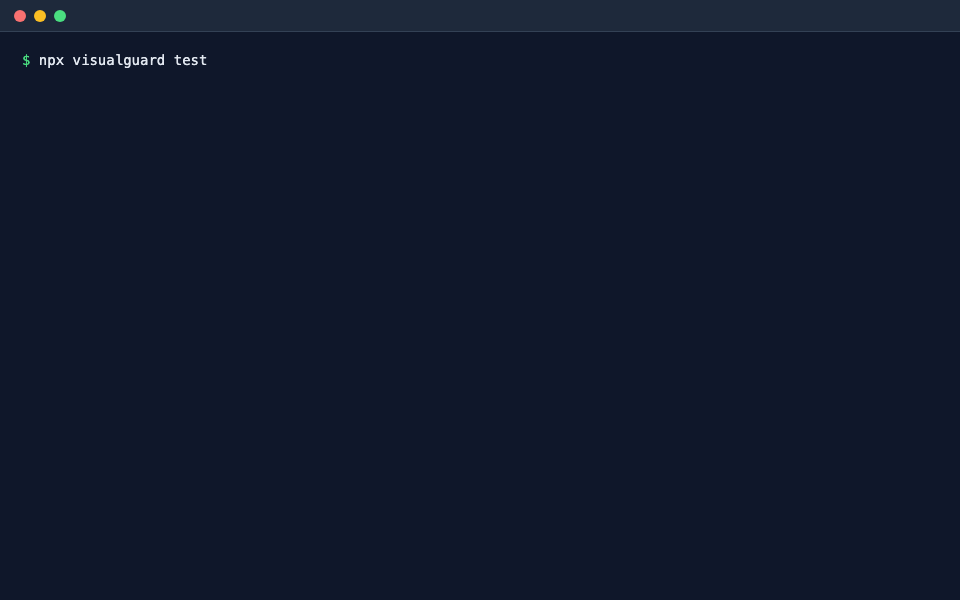

# VisualGuard 
DOCS - https://visualguard-ai-testing.vercel.app

[](https://www.npmjs.com/package/visualguard) [](https://github.com/ShubhamTiwari909/visualguard-ai-testing/actions/workflows/ci.yml) [](LICENSE) [](https://nodejs.org)

**Find visual changes, understand what changed, and fix regressions.**

VisualGuard uses Playwright to compare two versions of a website (for example production and staging), a site against saved baselines, or checkpoints inside your own browser tests. It shows what changed and where, with no AI required. Add Gemini or Ollama if you want explanations and suggested fixes.



> This README describes the source in this repository, which can be newer than the published npm release. Check [what changed between releases](docs/RELIABILITY-CHANGES.md) before upgrading.

## Quick start

You need Node.js 22.12 or newer.

```bash
npm install -D visualguard playwright
npx playwright install chromium
```

Compare two sites, with no config file and no AI:

```bash
npx visualguard https://example.com https://staging.example.com --no-ai
npx visualguard report
```

`report` opens an interactive report where you can compare screenshots side by side, with a slider, as an overlay, or as a diff.

Other quick runs:

```bash
npx visualguard https://example.com --no-ai                 # scan one site; later scans compare with the first
npx visualguard https://example.com/pricing https://staging.example.com/plans   # two specific pages
```

## Set up a project

```bash
npx visualguard init     # creates visualguard.config.ts (and optionally a GitHub workflow)
npx visualguard doctor   # checks your setup
npx visualguard test
```

A small `visualguard.config.ts`:

```ts
import { defineConfig } from "visualguard";

export default defineConfig({
  baseURL: {
    production: "https://example.com",
    staging: "http://localhost:3000",
  },
  routes: ["/", "/pricing", { path: "/checkout", mask: ["[data-testid=order-id]"] }],
  viewports: {
    desktop: { width: 1440, height: 900 },
    mobile: { width: 390, height: 844, isMobile: true, hasTouch: true },
  },
  ai: { provider: "none" },
});
```

Each page and viewport gets a status: `pass`, `accepted`, `review`, `regression` or `error`. `test` exits with an error on regressions (use `--fail-on review` to be stricter). Reports are saved in `.visualguard/runs/`; add that folder to `.gitignore` (`init` does this) and share the whole run folder, not just `index.html`.

## Everyday tasks

| I want to...                                    | Run                                                  |
| ----------------------------------------------- | ---------------------------------------------------- |
| See the planned pages without capturing         | `npx visualguard test --list`                        |
| Open the latest report                          | `npx visualguard report`                             |
| Mark a change as intentional                    | `npx visualguard accept /pricing --note "New plans"` |
| Explain differences with AI                     | `npx visualguard test --provider gemini`             |
| Propose and verify a fix                        | `npx visualguard fix`                                |
| Re-test as I edit code                          | `npx visualguard watch --staging http://localhost:3000` |
| Watch production for changes                    | `npx visualguard monitor https://example.com`        |
| Log in to an app before capturing               | `npx visualguard auth production`                    |
| Check accessibility and performance too         | `npx visualguard test --a11y --perf`                 |
| Re-analyze a saved run with AI                  | `npx visualguard analyze --run <run-id> --provider gemini` |
| Post a summary on a pull request                | `npx visualguard comment --link <artifact-url>`      |
| Upload a saved run to the dashboard             | `npx visualguard dashboard publish <run-dir> --project storefront --server <url>` |
| Run in CI                                       | `npx visualguard test --ci --junit visualguard-junit.xml` |
| Combine sharded CI runs                         | `npx visualguard merge <folder> --ci`                |

Run `npx visualguard <command> --help` for every option. Exit codes: `0` success, `1` failed or incomplete results, `2` configuration or usage error, `3` environment error.

For AI, set `GEMINI_API_KEY` (or run a local Ollama model). Without a key or with `--no-ai`, VisualGuard falls back to deterministic analysis.

## Use it in Playwright tests

```ts
import { test } from "visualguard/playwright";

test("cart opened", async ({ page, visualguard }) => {
  await page.goto("/shop");
  await page.getByRole("button", { name: "Cart" }).click();
  await visualguard.check(page, { name: "cart-open" });
});
```

## Share results with your team

The optional dashboard stores run history and lets people review changes, approve baselines and run tests from the browser. You do not need it for local testing or CI.

```bash
npx visualguard dashboard                                        # start it (SQLite, no setup)
npx visualguard dashboard project create storefront --name "Storefront" --server http://127.0.0.1:4400
npx visualguard test storefront --dashboard http://127.0.0.1:4400   # run and publish
```

Open `http://127.0.0.1:4400`, select the project, choose **Configure tests**, then **Run test**. The dashboard captures the pages itself with only your sign-in; no runner token is needed. A private runner (`dashboard runner`) is optional, for sites the dashboard cannot reach. (Token-free **Run test** is newer than the npm 3.2.3 release; with 3.2.3, connect a private runner.)

| Dashboard topic                            | Where to set it up                                                                     |
| ------------------------------------------ | -------------------------------------------------------------------------------------- |
| SQLite, projects, publishing, Run test     | [Install in your project](docs/NPM-PACKAGE-SETUP.md) · [Run this repository](docs/LOCAL-SETUP.md) |
| PostgreSQL or MongoDB                      | [PostgreSQL](apps/docs/src/content/docs/deployment/postgresql.md) · [MongoDB](apps/docs/src/content/docs/deployment/mongodb.md) |
| Login, Google sign-in, users and roles     | [Login](apps/docs/src/content/docs/dashboard/login.md) · [Google](apps/docs/src/content/docs/dashboard/google-sign-in.md) · [People](apps/docs/src/content/docs/dashboard/people-and-permissions.md) |
| Reviews, approved baselines, policies      | [Reviews](apps/docs/src/content/docs/dashboard/reviews.md) · [Baselines](apps/docs/src/content/docs/dashboard/approved-baselines.md) · [Policies](apps/docs/src/content/docs/dashboard/visual-policies.md) |
| Deploy to Vercel or Cloud Run, backups     | [Deployment](apps/docs/src/content/docs/deployment/overview.md) · [Backups](apps/docs/src/content/docs/deployment/storage-and-backups.md) |

## Learn more

| Guide                                                                      | What it covers                                                         |
| -------------------------------------------------------------------------- | ---------------------------------------------------------------------- |
| [Product feature tour](docs/PRODUCT-FEATURES.md)                           | What VisualGuard can do, in plain language.                            |
| [Command reference](docs/COMMAND-REFERENCE.md)                             | Every command, subcommand and important flag, with examples.           |
| [Install in your project](docs/NPM-PACKAGE-SETUP.md)                       | Step-by-step setup with the npm package, with or without a dashboard.  |
| [Run this repository](docs/LOCAL-SETUP.md)                                 | Try the demo and the dashboard from a source checkout.                 |
| [Configuration](apps/docs/src/content/docs/guides/configuration.md)        | Routes, viewports, stable captures, tolerances, AI and fix settings.   |
| [Section screenshot testing](docs/SECTION-SCREENSHOT-TESTING.md)           | Select one `data-*` container, configure routes, and verify cropped results. |
| [SDK for scripts and CI](docs/SDK-GUIDE.md)                                | Run comparisons from Node.js with structured verdicts, HTML/JUnit reports and CI artifacts. |
| [AI agent integration plan](docs/MCP-INTEGRATION-PLAN.md)                  | Proposed MCP support for Claude Code, Codex, and Gemini CLI. |
| [All guides and reference](apps/docs/src/content/docs/index.mdx)           | Baselines, Playwright, CI, sharding, API, deployment and troubleshooting. |
| [GitHub Action](action/README.md)                                          | Run VisualGuard in a workflow.                                         |
| [Next.js example](examples/nextjs/README.md)                               | Seed three regressions and repair them.                                |
| [Architecture](docs/PACKAGE-ARCHITECTURE.md) · [Reading the code](docs/READING-THE-CODE.md) | How the package is built.                          |

The same documentation is also a website: run `pnpm docs:dev` from this repository ([apps/docs](apps/docs/README.md)).

## Troubleshooting

| Problem                          | Try                                                                          |
| -------------------------------- | ---------------------------------------------------------------------------- |
| Browser executable missing       | `npx playwright install chromium`, then `npx visualguard doctor`.            |
| Wrong URLs or pages              | `npx visualguard test --list` shows what will run.                           |
| Expected change is not reported  | Check masks, ignored areas and `diff` tolerances in your config.             |
| AI is skipped                    | Check the provider, API key and `--no-ai`; deterministic analysis still runs. |
| Report is missing images         | Share the whole run folder under `.visualguard/runs/`.                       |

Reports can contain page text and screenshots; share them according to your data policy.

## Contributing

```bash
pnpm install
pnpm --filter visualguard exec playwright install chromium
pnpm build
pnpm test
```

See [CONTRIBUTING.md](CONTRIBUTING.md) for the full workflow, including lint, type checks and the evaluation suite.

## License

[MIT](LICENSE)
