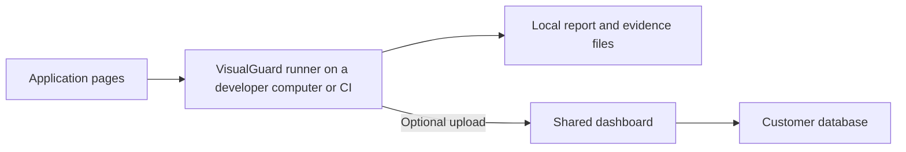

| Reader                  | Typical use                                                                       |
| ----------------------- | --------------------------------------------------------------------------------- |
| Developer               | Check a branch or local change before opening a pull request                      |
| QA engineer             | Compare important screens across releases and investigate differences             |
| Designer or reviewer    | Inspect screenshots and approve the intended appearance                           |
| Team lead or maintainer | Manage shared references and visual review requirements                           |
| Platform/operator       | Host the dashboard, manage access, preserve evidence and recover the installation |

VisualGuard tests pages a browser can open. It is not limited to the framework used to build those pages: React, Next.js, Vue and ordinary HTML applications can all be comparison targets.

A typical workflow is:

1. **Capture:** open the reference and candidate pages with repeatable browser settings.
2. **Compare:** identify changed pixels, affected elements and independent page problems.
3. **Inspect:** open a local report or publish evidence to the dashboard.
4. **Decide:** investigate a regression, accept an intentional local change, or record a team review.
5. **Reuse:** promote approved evidence as a future reference when appropriate.
6. **Check again:** use the same workflow locally, in CI or through a scheduled run.

The runner executes the browser. A dashboard can request an on-demand test when a private worker is connected; hosting the dashboard does not run a browser or create a managed schedule. See [private runners](/dashboard/private-runners/).

A **run** is one execution. A **check** is an individual page/viewport or interactive checkpoint comparison. A **baseline** is a saved expected appearance. A **project** groups an application's dashboard history and access permissions. A **revision** is the source commit associated with captured evidence.
