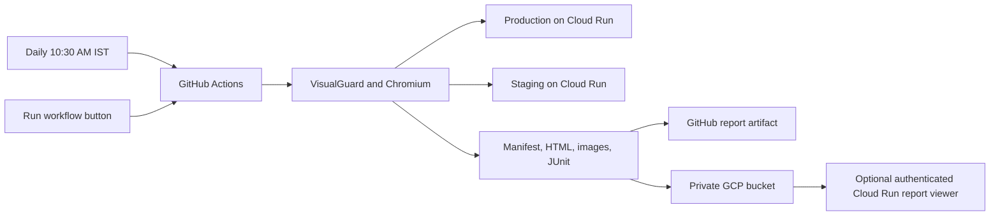

# Daily VisualGuard CI plan: GitHub Actions, Cloud Run, and GCP Storage

Status: proposed; no workflow, cloud resources, bucket permissions, or schedules have been created. Prepared on 2026-10-21 from the current VisualGuard implementation and official provider documentation.

Planning validation: both YAML schedule examples parse with manual and daily triggers; both proposed configuration profiles pass the current VisualGuard schema; upload/failure conditions and the 05:00 UTC to 10:30 IST conversion were checked. These are document/example checks, not a live GitHub Actions, Cloud Run, IAM, or bucket test. Formatting, lint, and type-check commands were not run.

## 1. Recommended setup

Run the installed VisualGuard package on a GitHub Actions runner. It opens the existing Cloud Run application URLs in Chromium, compares the configured pages or marked sections, and produces the normal VisualGuard evidence. Upload each complete run to GitHub artifacts and a private Google Cloud Storage bucket. Add an authenticated Cloud Run report viewer if the team needs a permanent browser link instead of downloading artifacts.

Cloud Run hosts the application under test and, optionally, a separate report viewer. The initial workflow does not deploy the application or move browser execution into a Cloud Run service. No VisualGuard dashboard database is required for this approach.



Use explicit CLI steps for this integration: they make the original test outcome, GCP authentication, evidence validation, and publication visible. The existing composite Action is still useful for a shorter workflow; section 13 explains how to use it without losing failure handling.

## 2. Assumptions and deployment inputs

The default design assumes 10:30 AM in **Asia/Kolkata**, every day, and compares production against staging. The main workflow example assumes publicly reachable application URLs; IAM-protected and internal-ingress variants are covered separately in section 8. These assumptions must be confirmed before activation.

| Input                                             | Purpose                                                                                            | Where it belongs                                          |
| ------------------------------------------------- | -------------------------------------------------------------------------------------------------- | --------------------------------------------------------- |
| Application repository and default branch         | Owns the workflow, config, dependencies, and lockfile.                                             | GitHub repository.                                        |
| Production and staging URLs                       | Actual deployed pages to compare. Prefer stable Cloud Run revision/tag URLs for reproducible runs. | Repository/environment variables, without tokens in URLs. |
| Routes, viewports, and section selectors          | Defines coverage and capture scope.                                                                | Committed `visualguard.config.ci.ts`.                     |
| GCP project ID, region, and report bucket         | Cloud location and evidence destination.                                                           | Repository variables.                                     |
| Workload Identity provider resource               | Trust relationship for the GitHub workload.                                                        | Repository variable.                                      |
| CI service-account email                          | Identity allowed to publish reports; optionally invoke protected services.                         | Repository variable.                                      |
| App test-user credentials/storage-state bootstrap | Required only for application login.                                                               | GitHub environment secrets or an approved secret store.   |
| Viewer URL and viewer access group                | Optional permanent report browsing.                                                                | Configure in the viewer phase.                            |

Do not infer the deployed application revision from `github.sha`. That value identifies the workflow checkout, which can differ from the code already running in Cloud Run. Record both identities when the application exposes a version endpoint or deployment metadata.

If production and staging resolve to the same deployment, the job can look healthy while providing little regression coverage. Choose a meaningful reference and validate both environments before enabling the daily schedule.

## 3. Daily and manual triggers

GitHub's current documentation supports a timezone directly on a scheduled cron entry. The proposed trigger is:

```yaml
on:
  workflow_dispatch:
  schedule:
    - cron: "30 10 * * *"
      timezone: "Asia/Kolkata"
```

This requests a run every day at 10:30 AM IST, equivalent to 05:00 UTC. A UTC-only alternative is `cron: "0 5 * * *"` with no timezone entry; use one scheduling form, not both. See [GitHub workflow schedule syntax](https://docs.github.com/en/actions/reference/workflows-and-actions/workflow-syntax#onschedule).

Merge the workflow into the default branch before activation. Scheduled jobs use that branch. Keep the manual workflow restricted to the intended trusted branch when it receives cloud credentials. GitHub's Actions page provides the **Run workflow** button for `workflow_dispatch`.

A schedule requests a start time; GitHub does not guarantee an exact launch at that minute. Scheduled jobs can be delayed or dropped under load, and inactive public repositories can have schedules disabled. Add a missed-run check if this becomes operationally important. If exact dispatch timing is mandatory, consider a separately authorized Cloud Scheduler invocation of GitHub's dispatch API; that still does not guarantee immediate runner availability. See [GitHub schedule behavior](https://docs.github.com/en/actions/reference/workflows-and-actions/events-that-trigger-workflows#schedule).

## 4. One-time application setup

1. Add `visualguard` and `playwright` as exact dev dependencies in the application repository and commit the lockfile. Select a verified published VisualGuard build containing every required feature and packaged report assets. Section capture requires a release containing `screenshot.selector`; source changes are not automatically available from npm.
2. Install Chromium on the CI runner using the Playwright version resolved from the application lockfile.
3. Commit `visualguard.config.ci.ts`; keep credentials and saved browser sessions out of Git.
4. Run the same configuration manually against the real Cloud Run URLs before scheduling it.
5. Verify a complete report contains HTML, screenshots, and image diffs. A CLI version printout alone does not validate report packaging.

Typical initial package installation, run once by a maintainer:

```sh
npm install --save-dev --save-exact visualguard playwright
npx --no-install playwright install chromium
```

Use `npm ci` in CI. Do not install `visualguard@latest` on every scheduled run: a lockfile makes failures and screenshots easier to reproduce. Upgrade the package/browser deliberately through normal dependency updates.

This example targets an application using npm. This VisualGuard source workspace uses pnpm: its equivalent is the configured pnpm version, `pnpm install --frozen-lockfile`, and `pnpm exec` from the application package. Use that package's lockfile and working directory in a monorepo.

## 5. Proposed VisualGuard configuration

Create this file in the application repository when implementing the plan. Replace example routes with pages that exist and have consistent data on both deployments.

```ts
import { defineConfig } from "visualguard";

const production = process.env.VISUALGUARD_PRODUCTION_URL;
const staging = process.env.VISUALGUARD_STAGING_URL;
if (!production || !staging) {
  throw new Error("Set both VisualGuard Cloud Run URLs before starting CI.");
}

const profile = process.env.VISUALGUARD_PROFILE ?? "critical";
if (!["critical", "full"].includes(profile)) {
  throw new Error("VISUALGUARD_PROFILE must be critical or full.");
}

const criticalRoutes = [
  { path: "/", name: "Home" },
  { path: "/pricing", name: "Pricing" },
  {
    path: "/checkout",
    name: "Checkout section",
    screenshot: { selector: '[data-visualguard="checkout"]' },
  },
];

export default defineConfig({
  mode: "compare",
  baseURL: { production, staging },
  routes:
    profile === "full"
      ? [...criticalRoutes, { path: "/contact", name: "Contact" }]
      : criticalRoutes,
  viewports: {
    desktop: { width: 1440, height: 900 },
    mobile: { width: 390, height: 844 },
  },
  browser: {
    name: "chromium",
    locale: "en-US",
    timezoneId: "Asia/Kolkata",
    colorScheme: "light",
  },
  screenshot: { fullPage: true, maxHeight: 15000 },
  stabilize: { disableAnimations: true },
  diff: { threshold: 0.1, maxDiffPixels: 20 },
  concurrency: 2,
  ai: { provider: "none" },
  checks: { accessibility: false, performance: false },
  output: { dir: ".visualguard-ci", keepRuns: 1 },
  report: { githubSummary: true },
});
```

On both deployments, the checkout container must have markup such as:

```html
<section data-visualguard="checkout">...</section>
```

Only that section's pixels are compared for the checkout job. Other configured routes remain page captures. A missing, hidden, duplicate, or oversized section is a capture error, not a fallback to a page screenshot. See [section screenshot testing](SECTION-SCREENSHOT-TESTING.md).

The `critical` profile above produces three targets at two viewports: six jobs and at least twelve primary reference/candidate captures. Stability shots, retries, or noise-map recaptures add work. Start with this small stable scope, then expand to `full` after measuring run duration and artifact size.

Important settings:

| Setting           | Recommended initial choice                                       | What it controls                                                                                                                                                       |
| ----------------- | ---------------------------------------------------------------- | ---------------------------------------------------------------------------------------------------------------------------------------------------------------------- |
| Failure policy    | CLI `--fail-on review`.                                          | Makes both Review and Regression changes actionable; capture/config/environment errors must also fail. Use `regression` only if informational reviews are intentional. |
| AI                | `none` and `--no-ai`.                                            | Establishes predictable capture/diff behavior without extra model calls. Add Gemini later with explicit budgets if useful.                                             |
| Viewports/browser | One Chromium engine, desktop and mobile.                         | Limits cost and keeps the rendering environment stable.                                                                                                                |
| Dynamic content   | Stable test data and narrowly marked ignored descendants.        | Reduces noise without masking an entire section or relaxing every threshold.                                                                                           |
| Optional checks   | Accessibility/performance off initially.                         | Enable separately after reviewing their expected findings. Section capture does not restrict these checks to the section.                                              |
| Baseline changes  | Never update in the daily workflow.                              | Prevents a daily run from accepting the very change it should detect.                                                                                                  |
| Test profile      | Fixed `critical` schedule; allowlisted manual `critical`/`full`. | Expands coverage without accepting arbitrary shell arguments or URLs from an input.                                                                                    |

## 6. What the CI run does

1. Check out the trusted application branch and install locked dependencies.
2. Install Chromium and its Linux dependencies.
3. Prepare application login, Cloud Run invocation authentication, or networking when required.
4. Check the config, browser, expected URLs, and authenticated readiness. A 200 response that is actually a login/error page is not sufficient; verify an application-specific marker/version.
5. Preview target coverage with `test --list`.
6. Run `visualguard test --ci --no-ai --fail-on review --junit ...` and retain its actual outcome.
7. Validate that the saved run belongs to this execution and has the expected job coverage, readable manifest, HTML entry point, and referenced artifacts. A report may legitimately contain failing/error jobs; preserve that evidence.
8. Stage only report/evidence files in a nonhidden artifact folder.
9. Upload the staged folder to GitHub artifacts even when the comparison fails.
10. Obtain fresh Google credentials shortly before upload, then upload to a unique bucket prefix.
11. Append the artifact link, archive location, comparison scope, and publication outcome to the GitHub job summary.
12. Fail the job if testing, required coverage, packaging, or required publication failed. Publishing a report never changes a failing comparison into a pass.

Failures before capture should produce diagnostic metadata saying no comparison completed. A missing HTML report, missing screenshot, or partially uploaded archive must not be presented as a valid passing report. The packaging helper must retain raw engine results instead of manufacturing a success manifest.

## 7. GCP authentication and bucket setup

Use GitHub OIDC with Workload Identity Federation rather than storing a service-account JSON key. A service-account-backed setup is practical when the same CI identity needs both bucket access and Cloud Run invocation. Direct federation is also supported; the IAM design should match the chosen flow. [Google's auth Action](https://github.com/google-github-actions/auth) documents the setup and requires checkout before authentication.

One-time administrator work:

1. Choose the GCP project and report bucket, preferably colocated with the optional viewer. Use a dedicated private bucket or a clearly separated report prefix.
2. Enable the required IAM/service-account credential and Cloud Storage APIs for the chosen federation setup; enable Cloud Run/IAP APIs only for the components actually used.
3. Create a dedicated CI service account and Workload Identity pool/provider for GitHub's OIDC issuer.
4. Restrict provider admission to the intended repository/owner identities and trusted branch/workflow claims; use stable numeric repository/owner IDs where available. Match any GitHub environment subject policy deliberately.
5. Allow the federated principal to impersonate only that service account with `roles/iam.workloadIdentityUser`.
6. Grant only the bucket permissions needed by the selected upload method. For the draft `gcloud storage rsync` flow, a bucket-scoped `roles/storage.objectUser` is a simple supported role; do not grant project-wide Storage Admin or project Editor. If using immutable create-only copying instead, prove a narrower create/read/list role combination with the actual upload command before activation.
7. Give report readers or the viewer identity `roles/storage.objectViewer` on the report bucket. Give CI `roles/run.invoker` only on protected application services if needed; it needs no Cloud Run deployment permission for ordinary tests.
8. Enable uniform bucket access/public-access prevention as appropriate and define retention/lifecycle rules. Initial planning values are 14 days for GitHub artifacts and 90 days for bucket reports; confirm operational requirements and costs.

Bucket roles differ in overwrite/delete capability; see [Cloud Storage IAM roles](https://docs.cloud.google.com/storage/docs/access-control/iam-roles). Lifecycle expiration is configured by an administrator, not by the test job; see [Object Lifecycle Management](https://docs.cloud.google.com/storage/docs/lifecycle).

Authenticate near the upload rather than only at job startup: federation credentials can be short-lived. Use `gcloud storage`, not `gsutil`, with the credentials exported by Google's Action. Bound publication time and refresh credentials/retry uploads through the supported auth flow if the upload cannot finish within credential validity. Keep generated `gha-creds-*.json` files out of all archives and version control.

## 8. Public, IAM-protected, and private-network Cloud Run services

| Application access                            | CI approach                                                                                                                           | Additional work                                                                                                                                                |
| --------------------------------------------- | ------------------------------------------------------------------------------------------------------------------------------------- | -------------------------------------------------------------------------------------------------------------------------------------------------------------- |
| Publicly reachable application endpoints      | GitHub-hosted Linux runner captures the configured HTTPS URLs.                                                                        | Application login/test data if relevant. This is the main draft workflow below.                                                                                |
| IAM-protected endpoint with reachable ingress | Federate to an allowed identity, obtain a Google-signed ID token for each service audience, and attach it to that service's requests. | `roles/run.invoker`, token lifetime/refresh, authenticated preflight, and origin-scoped token delivery.                                                        |
| Internal ingress/private network              | Use a GitHub Actions runner with a supported route into the GCP network, typically a self-hosted runner in the VPC.                   | Networking, DNS, egress for GitHub/dependencies, and the IAM/app-login configuration above. Authentication alone cannot make an unreachable service reachable. |

For IAM authentication, Google supports `X-Serverless-Authorization: Bearer ID_TOKEN` when the application's own `Authorization` header is needed separately. The audience should be the service URL or an explicitly configured custom audience; traffic-tag requests still need the correct service audience. Mint separate tokens for separate services and avoid printing them. See [Cloud Run service-to-service authentication](https://docs.cloud.google.com/run/docs/authenticating/service-to-service).

VisualGuard currently supports environment headers, but those headers are attached at browser-context level. Do not blindly put a service ID token in a global header and forward it to every third-party origin. The protected-service implementation must use a vetted origin-aware hook/auth proxy, handle redirects and subresources, and prove no token reaches unrelated hosts. Apply equivalent authentication to preflight checks; `doctor`/URL reachability do not execute browser navigation hooks.

Cloud Run IAM invocation and the application's own login are separate layers. Bootstrap a least-privilege test account per environment, save browser state into a temporary ignored directory, and delete it afterward. Never upload storage-state files, passwords, raw config containing secrets, or federation credentials with reports.

## 9. Report storage and what users will see

The GitHub job summary already supported by VisualGuard shows per-job status and findings. Add links after publication because the final artifact URL is not known at capture startup. Daily/manual runs have no pull request to comment on; do not attempt automatic PR comments in this workflow.

Archive layout:

```text
visualguard-artifacts/
  execution.json                   # CI outcome, versions, scope, deployment identities
  visualguard-junit.xml             # when produced
  runs/<engine-run-id>/
    index.html
    manifest.json
    jobs/<job-id>/
      production.png
      staging.png
      ...diff and region-crop files referenced by the manifest...
      ...available DOM evidence...
```

Use a unique remote prefix such as:

```text
gs://REPORT_BUCKET/visualguard/OWNER/REPOSITORY/YYYY-MM-DD/GITHUB_RUN_ID/attempt-GITHUB_RUN_ATTEMPT/
```

Keep the whole hierarchy intact. VisualGuard inlines the UI code and manifest data in `index.html`, but the screenshot/diff/crop files are relative assets. Copying only `index.html` breaks those views. The current report renderer is `packages/visualguard/src/reporters/html.ts`.

The report lets users inspect reference and candidate images, side-by-side/slider/overlay/diff views, changed regions and crops, plain-language DOM findings, health findings, and optional AI analysis when enabled. A daily runner does not need to leave `visualguard report` running: static evidence is sufficient.

JUnit is available for machine-readable results. Uploading XML alone does not create GitHub test annotations; a separate JUnit/check publisher can be added later if needed. A workflow's red/green outcome and its Markdown summary work without that extension.

### Initial viewing: GitHub artifact or private bucket download

Open **Actions → VisualGuard daily → run → Summary**, then download the report artifact. Extract the entire artifact and open `runs/<engine-run-id>/index.html` locally. Keep its neighboring files intact. GitHub's artifact link is a download, not a public HTML website.

Authorized bucket users can instead download the matching complete prefix with `gcloud storage rsync --recursive gs://.../attempt-N/ ./downloaded-report`, then open the same run HTML locally. The upload identity and a reader's interactive identity are separate; don't distribute CI credentials to viewers.

### Browser viewing: optional authenticated Cloud Run report viewer

Add a separate, read-only service that reads report objects from the private bucket and serves a stable path such as `/reports/OWNER/REPO/RUN_ID/attempt-N/runs/ENGINE_RUN_ID/index.html`. All relative assets must be served under that same path and authenticated browser session.

Use a supported browser-authentication layer such as IAP and grant the team's group access. The viewer service identity gets object-read access, not CI upload/admin rights. Resolve only known report prefixes, reject traversal, set correct HTML/PNG/JSON content types, and show publication/incomplete status clearly. Treat archived report HTML as active content: use an isolated report origin and verify any response policy does not break the current inlined viewer. [Cloud Run IAP documentation](https://docs.cloud.google.com/run/docs/securing/identity-aware-proxy-cloud-run) describes the browser access layer.

A signed URL authorizes access to its signed object; signing `index.html` alone does not sign relative PNG requests. Keep this as a download flow or design per-asset authorization/rewrite explicitly. The authenticated viewer avoids making the bucket public. See [Cloud Storage signed URLs](https://docs.cloud.google.com/storage/docs/access-control/signed-urls).

GCS is an external archive/publication destination in this design. VisualGuard does not currently have a `bucket` config field or a GCS-backed screenshot-store adapter for its shared dashboard. The optional viewer is new application work, not a property gained automatically by uploading files. A full existing VisualGuard dashboard is another option, but requires its supported database and publishing setup separately.

## 10. Draft GitHub workflow

This is a design template, not an active workflow. Its two helper files are specified in section 11 and must be implemented and tested before copying it into `.github/workflows/visualguard-daily.yml`. It assumes public Cloud Run URLs; implement section 8 first for protected targets.

Action major versions were checked during planning. Before activation, pin reviewed full commit SHAs for the external Actions instead of leaving floating major tags. The npm dependency/browser versions come from the application's lockfile.

```yaml
name: VisualGuard daily

on:
  workflow_dispatch:
    inputs:
      profile:
        description: Visual coverage
        type: choice
        options: [critical, full]
        default: critical
  schedule:
    - cron: "30 10 * * *"
      timezone: "Asia/Kolkata"

permissions:
  contents: read

concurrency:
  group: visualguard-daily-${{ github.repository }}
  cancel-in-progress: false

jobs:
  compare:
    if: github.ref == format('refs/heads/{0}', github.event.repository.default_branch)
    runs-on: ubuntu-24.04
    timeout-minutes: 30
    permissions:
      contents: read
      id-token: write
    env:
      VISUALGUARD_PRODUCTION_URL: ${{ vars.VISUALGUARD_PRODUCTION_URL }}
      VISUALGUARD_STAGING_URL: ${{ vars.VISUALGUARD_STAGING_URL }}
      VISUALGUARD_PROFILE: ${{ inputs.profile || 'critical' }}
      VISUALGUARD_REPORT_BUCKET: ${{ vars.VISUALGUARD_REPORT_BUCKET }}
    steps:
      - uses: actions/checkout@v7
      - uses: actions/setup-node@v7
        with:
          node-version: 24
          cache: npm
      - run: npm ci
      - run: npx --no-install playwright install --with-deps chromium

      - name: Validate setup
        run: npx --no-install visualguard doctor --config visualguard.config.ci.ts
      - name: Preview coverage
        run: npx --no-install visualguard test --config visualguard.config.ci.ts --list

      - name: Compare Cloud Run applications
        id: visual
        continue-on-error: true
        run: >-
          npx --no-install visualguard test
          --config visualguard.config.ci.ts
          --ci --no-ai --fail-on review
          --junit visualguard-junit.xml

      - name: Collect and validate evidence
        id: package
        if: always()
        env:
          VISUALGUARD_TEST_OUTCOME: ${{ steps.visual.outcome }}
        run: node scripts/visualguard/package-report.mjs

      - name: Upload GitHub evidence
        id: artifact
        if: always() && steps.package.outputs.has_bundle == 'true'
        uses: actions/upload-artifact@v7
        with:
          name: visualguard-${{ github.run_id }}-${{ github.run_attempt }}
          path: visualguard-artifacts/
          if-no-files-found: error
          retention-days: 14

      - name: Authenticate for report archive
        id: auth
        if: always() && steps.package.outputs.has_bundle == 'true'
        uses: google-github-actions/auth@v3
        with:
          project_id: ${{ vars.GCP_PROJECT_ID }}
          workload_identity_provider: ${{ vars.GCP_WORKLOAD_IDENTITY_PROVIDER }}
          service_account: ${{ vars.GCP_VISUALGUARD_SERVICE_ACCOUNT }}

      - name: Set up Cloud SDK
        id: gcloud
        if: always() && steps.auth.outcome == 'success'
        uses: google-github-actions/setup-gcloud@v3

      - name: Archive complete evidence bundle
        id: archive
        if: always() && steps.gcloud.outcome == 'success'
        env:
          VG_ARCHIVE_PREFIX: ${{ steps.package.outputs.archive_prefix }}
        run: >-
          gcloud storage rsync --recursive
          visualguard-artifacts/
          "gs://$VISUALGUARD_REPORT_BUCKET/$VG_ARCHIVE_PREFIX/"

      - name: Publish links and preserve the result
        if: always()
        env:
          VG_TEST_OUTCOME: ${{ steps.visual.outcome }}
          VG_PACKAGE_OUTCOME: ${{ steps.package.outcome }}
          VG_ARTIFACT_OUTCOME: ${{ steps.artifact.outcome }}
          VG_ARCHIVE_OUTCOME: ${{ steps.archive.outcome }}
          VG_ARTIFACT_URL: ${{ steps.artifact.outputs.artifact-url }}
          VG_ARCHIVE_PREFIX: ${{ steps.package.outputs.archive_prefix }}
        run: node scripts/visualguard/finalize-report.mjs
```

`continue-on-error` applies only to the comparison step so reporting can continue; the final helper must restore failure. Publication steps intentionally run after failed visual tests. Existing earlier step failures also remain failures. Do not add job-wide `continue-on-error` or an unconditional final success.

GitHub concurrency limits overlapping active runs, but is not a durable queue guaranteeing every pending dispatch executes. If every invocation must be preserved, design a separate queue. A cancelled/force-stopped job may not finish evidence publication, so record that state distinctly rather than expecting `always()` to overcome runner termination.

## 11. Planned helper contracts

### `scripts/visualguard/package-report.mjs`

- Validate the profile and parse the generated run index using the public `findRun`/`readManifest` API or equivalently validated manifest input. Use this execution's output directory, not an arbitrary “latest” object in GCS.
- Verify expected coverage against the planned section-aware jobs, the run's timestamps/identity, report entry point, and referenced artifacts. Check packaging independently of whether jobs passed or failed visually.
- Stage the complete run tree and JUnit when present into `visualguard-artifacts/`, a nonhidden directory. Do not upload the entire repository or `.visualguard` caches/secrets indiscriminately.
- Write `execution.json` recording event, actual start/end times in UTC and IST, profile, package/Playwright/Node versions, workflow SHA, available deployment IDs, test outcome, comparison completeness, and publication state. Redact secrets and token-bearing URLs.
- If capture never completed, create a diagnostic bundle with an explicit incomplete status. Set a failure outcome while still publishing `has_bundle=true` when diagnostics are available.
- Write validated `has_bundle` and `archive_prefix` to `GITHUB_OUTPUT`. Build the prefix from trusted repository/run/attempt metadata, not free-form manual text. Return nonzero for invalid/missing required evidence; the workflow can still archive diagnostics through its `always()` steps.

### `scripts/visualguard/finalize-report.mjs`

- Append comparison status, observed coverage, missing-evidence errors, GitHub artifact link, authenticated GCS console/location link, and upload outcomes to `GITHUB_STEP_SUMMARY`.
- Add a viewer link only after the corresponding publication has been verified and the viewer exists. A `gs://` location is an archive identifier, not a browser HTML link.
- Keep visual verdict and publication status separate. A regression with a successfully uploaded report still fails; a passing comparison with a failed required archive also fails.
- Return nonzero unless the comparison completed successfully under `--fail-on review`, packaging/coverage validation passed, and both required publication channels succeeded.
- Avoid printing secrets, raw headers, storage state, or federation-token paths. Do not mutate acceptance or baseline files.

The draft publication order gives GitHub artifacts a chance to succeed even if GCP authentication fails. A GCS upload failure can leave a partial prefix; do not publish a “complete” viewer entry for it. Add a final completion record after verified upload in the viewer phase and list only completed publications. Do not maintain a mutable `latest` pointer in the initial workflow.

## 12. Efficiency and reliability

- Cache package-manager downloads using the lockfile. Start by installing only Chromium; measure before adding browser-binary caches that can mismatch browser/OS versions or cost more to restore than install.
- Pin the runner OS, Node major, package/browser versions, routes, viewports, locale, timezone, and theme. Revalidate approved baselines after deliberate rendering-environment changes.
- Run a small critical route/section set daily and offer a manual full profile. Use low concurrency initially to avoid application load and browser memory spikes.
- Freeze or seed known dynamic data and use narrow ignore markers. Keep time-sensitive business behavior in separate checks rather than masking entire screens.
- Use actual deployed URLs instead of rebuilding/redeploying the app just to take screenshots. Record service revisions and avoid capturing during a rolling deployment when reference/candidate revisions can change mid-run.
- Preserve failure evidence before returning a nonzero outcome. Don't blindly retry every visual failure: retries can hide a real issue. Distinguish network/setup retries from deterministic diffs.
- Use immutable prefixes with run attempt IDs; never use a date alone, because manual reruns can otherwise overwrite each other.
- Set retention intentionally and measure bytes per run. Monthly capture/CI/storage usage depends on target count, viewports, retries, run duration, report size, and download traffic; avoid fixed cost promises before measurement.
- A scheduled test is an observation of deployed applications, not a deployment-blocking check for code merged earlier. Add a separate post-deploy/PR gate later if that is required.

## 13. Using the existing VisualGuard composite Action instead

The repository already provides `action/action.yml`, including browser setup, CI execution, JUnit, GitHub artifact upload, summary support, and final failure. It does not upload to GCS or create a bucket report viewer.

If choosing it instead of the explicit CLI steps:

1. Install locked application dependencies first and pin a reviewed Action commit containing the required inputs.
2. Set `comment: "false"` for daily/manual runs, `fail-on: review`, `args: --config visualguard.config.ci.ts --no-ai`, the correct output/JUnit paths, and the appropriate package-manager executable.
3. Retain its original test output and failed Action outcome; ensure GCS and summary steps use `if: always()` and that final workflow status preserves failure.
4. Keep the GCP authentication/publication and complete-tree validation stages from this plan.
5. Verify the chosen Action revision uploads dot-directory evidence as intended with its artifact action version. The explicit draft stages a nonhidden directory to avoid depending on hidden-file defaults.

Use either browser installation path, not both. The initial recommendation is explicit CLI orchestration because GCP publication, private Cloud Run access, and failure preservation need clear independent steps.

## 14. Alternative: one deployment against approved baselines

If there is no useful staging deployment, configure baseline mode against production as the current target. Store reviewed baseline PNGs, metadata, and companion evidence in Git or in a separately controlled baseline source; fetch a specific approved version before the run.

A fresh GitHub runner has no previous local run. Downloading the latest report archive is not the same as selecting an approved baseline. Keep report archives and approved references under separate ownership and paths. Baseline identity includes rendering settings and section scope, so a full-page reference cannot be reused for a cropped section.

Generate/update references in a separate explicit approval workflow, never in the 10:30 AM test. If using VisualGuard's shared approved baselines, use its existing authenticated baseline-pull workflow and preserve version provenance. Ordinary monitoring can roll snapshots forward; do not substitute that behavior for an approved-reference regression gate accidentally.

## 15. Implementation phases and acceptance criteria

| Phase                                | Work                                                                                                                                                                             | Completion criteria                                                                                                                                   |
| ------------------------------------ | -------------------------------------------------------------------------------------------------------------------------------------------------------------------------------- | ----------------------------------------------------------------------------------------------------------------------------------------------------- |
| CI01 — confirm scope and local proof | Confirm time zone, URLs, app access model, branch, package manager, section support, profile and failure policy. Commit config/dependencies in the application repository.       | A local run captures the intended application/sections and produces a complete report with the selected published package.                            |
| CI02 — manual GitHub comparison      | Add `workflow_dispatch`, pinned tools, preflight, helper scripts, summaries, and GitHub artifacts. Use production/staging public flow or complete required private access first. | Manual success and intentional visual failure both produce usable artifacts; missing section/config/browser conditions fail correctly.                |
| CI03 — GCP archive                   | Configure federation, least-privilege bucket access, unique prefixes, complete uploads, publication outcomes, and retention.                                                     | No long-lived GCP key is needed; upload failure stays visible; downloaded bucket evidence renders all images.                                         |
| CI04 — daily schedule                | Add timezone-aware daily trigger on the default branch and nonoverlap policy.                                                                                                    | Observe the first scheduled run, confirm the intended IST date/time and scope, retain manual triggering, and document delay/missed-run handling.      |
| CI05 — authenticated browser reports | Implement the optional read-only Cloud Run bucket viewer, user access, artifact routing, and completion metadata.                                                                | Authorized users open a report URL and all PNGs/crops load; unauthorized users cannot read reports; failed/partial uploads are clearly distinguished. |
| CI06 — expand coverage               | Add selected full profiles/browsers, optional AI/a11y/performance, notifications, or a separate post-deploy gate as requested.                                                   | New capabilities have measured duration/storage impact and their own focused validation.                                                              |

Keep this planning commit separate. Implement only the requested phase at each step, with phase implementation, docs, and focused checks together. Under the current repository instructions, formatting, lint, and type-check commands remain deferred. No live GitHub or GCP configuration has been changed by preparing this plan.

## 16. Verification checklist for implementation

- Manual critical/full profile works on the trusted branch; unsupported input/branch does not receive cloud access.
- The scheduled workflow requests 10:30 AM Asia/Kolkata and exists on the default branch; the UTC conversion is correct and there is no duplicate schedule.
- An intentional inside-section change is detected; outside-only changes do not change section pixels; page-wide health findings still apply.
- Missing/hidden/duplicate selectors, missing baselines, failed authentication, wrong deployments, and browser/config errors fail distinctly.
- A failing comparison still produces HTML, manifest, images, and JUnit when the engine could produce them.
- GitHub download and GCS download both retain relative image paths. A private signed HTML link is not falsely advertised as a working complete viewer.
- Dependency/config/GCP failures, cancelled jobs, missing reports, and partial uploads never appear as successful visual tests.
- Locked package and report assets work in a fresh runner outside the source repository.
- Federation admission and bucket/service permissions are tested with the actual CI identity; app tokens and browser storage are absent from archives.
- IAM/private-network variants validate real page and subresource access without exposing credentials to unrelated origins.
- A manual rerun uses a new attempt prefix and does not overwrite a previous report.
- Retention, notification ownership, missed-run handling, and first scheduled observation are recorded before treating the job as operational.
