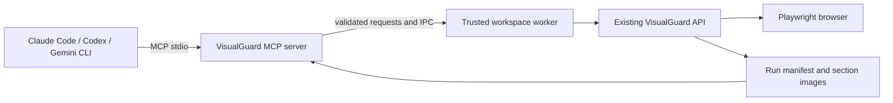

# VisualGuard MCP integration plan

Status: proposed; implementation has not started. Research checked on 2026-10-21. Client configuration and SDK versions must be rechecked during implementation.

## 1. Recommendation

Build one optional VisualGuard MCP server, starting with a local stdio transport. Give Claude Code, Codex, and Gemini CLI the same tools to plan comparisons, start a configured run, follow progress, and inspect evidence. Add a hosted Streamable HTTP connection later for shared dashboard access. Client-specific extensions or marketplace connectors can package that shared server after the core workflow is proven.

MCP is the interface between an agent and VisualGuard. It does not replace VisualGuard's capture engine or require changing its AI provider. The agent can explain results using its own model; the initial server should run with VisualGuard's additional AI analysis disabled. No extra model API key is needed for that deterministic testing workflow; users still need their chosen agent's normal access.

This document proposes future tools, package paths, and setup examples. There is currently no VisualGuard MCP executable, registered connector, hosted MCP endpoint, or published MCP package. Do not run the proposed configuration examples until the corresponding implementation exists.

## 2. What official client documentation establishes

| Client or standard | Verified capability | Consequence for VisualGuard |
| --- | --- | --- |
| Claude Code | Local stdio servers and remote HTTP servers; local servers can be registered with `claude mcp add`. | Start with a local command and document Claude Code separately from Claude web/Desktop. [Official Claude Code guide](https://code.claude.com/docs/en/mcp). |
| Codex | Supports stdio and Streamable HTTP, command arguments, environment settings, and a working directory. | Provide a `config.toml` example and a registration command. Desktop/cloud reachability must be tested for the intended host. [Official OpenAI documentation](https://developers.openai.com/codex/mcp). |
| Gemini CLI | Supports stdio and Streamable HTTP through `mcpServers` configuration, plus tool/resource discovery. | Provide a `.gemini/settings.json` example; check schema and image handling in a real client. [Official Gemini CLI guide](https://geminicli.com/docs/tools/mcp-server/). |
| MCP | Defines stdio and Streamable HTTP transport bindings. | Reuse a supported SDK and keep the tool contract independent of transport. [MCP transports](https://modelcontextprotocol.io/specification/2026-07-28/basic/transports). |
| TypeScript SDK | The official documentation currently identifies v2 as stable; v1 is a maintenance line. | Evaluate `@modelcontextprotocol/server` and the corresponding client package for tests. Verify legacy-client compatibility before selecting and pinning a release. [Current SDK documentation](https://ts.sdk.modelcontextprotocol.io/v2/). |

These are client capabilities, not tested VisualGuard integrations. Supporting Gemini CLI does not automatically support every Gemini chat product; the same distinction applies to Claude Code and other Claude surfaces. A local stdio process also does not automatically become reachable from a cloud agent.

## 3. User workflow

A first supported request should be:

> Compare the checkout section on production and staging using this project's configuration. Show the differences and explain any failures. Keep the existing baselines unchanged.

The user first marks the container and configures it as described in [section screenshot testing](SECTION-SCREENSHOT-TESTING.md):

```html
<section data-visualguard="checkout">...</section>
```

```ts
screenshot: { selector: '[data-visualguard="checkout"]' }
```

The agent then:

1. Reads server capabilities and the configured target list.
2. Selects the checkout job IDs and requests a run.
3. Receives an operation ID immediately, then polls status until completion.
4. Reads the engine verdict, completeness information, findings, and evidence references.
5. Requests reference/candidate/diff images when useful and reports the actual result.
6. If the user asks the agent to edit the application, the agent uses its existing editor tools and reruns the same targets afterward. The MCP server does not silently apply a fix or approve a visual change.

The initial version uses sections already configured in `visualguard.config.ts`. Automatically discovering every `data-*` marker, generating configuration, recording journeys, and accepting arbitrary browser scripts are separate features.

## 4. Existing implementation to reuse

| Existing module | Reuse | Integration detail |
| --- | --- | --- |
| `packages/visualguard/src/index.ts` | Public API exports. | Import the package API rather than deep-importing internal capture files. |
| `src/config/load.ts` and `src/config/resolve.ts` | Config discovery, validation, environment handling, and runtime settings. | Load the trusted workspace's config once for a prepared profile. Never return its headers, storage-state contents, environment variables, or hook source. |
| `src/core/jobs.ts` | `planJobs` and stable job IDs. | List actual section-aware jobs and preserve per-route overrides; do not rebuild selector semantics in the adapter. |
| `src/core/run.ts` | `createRun`, `RunOptions`, reporters, and `AbortSignal`. | Pass run mode and baseline directory explicitly. `createRun(config)` alone defaults to compare mode even if config describes a baseline workflow. |
| `src/core/events.ts` | Run/job start/end events and warnings. | Convert events into bounded operation progress. Progress is informative and cannot replace a final manifest. |
| `src/core/runs.ts` | Saved run index and manifests. | Validate saved evidence and scope lookups to the configured output directory. |
| `src/core/status.ts` | Summary and exit/failure policy helpers. | Keep engine status separate from operation completion and reviewer approval. |
| `src/capture/capture.ts` and `src/core/provenance.ts` | Section capture, reliability checks, and baseline identity. | Exercise these through the engine; do not crop arbitrary saved page images or bypass baseline compatibility. |

The repository currently has no MCP server dependency or implementation. It already has the engine contracts needed for an adapter; operation persistence, MCP schemas, content filtering, and client interoperability are new work.

## 5. Architecture and packaging

Use a separate optional workspace package, provisionally `packages/visualguard-mcp`, so installing the normal CLI does not require MCP dependencies. A candidate npm name is `visualguard-mcp`; availability and ownership must be confirmed before publication. Match the adapter's supported engine range to an actual release containing section capture. Do not assume the current npm `latest` includes unshipped source changes.

Suggested layout:

```text
packages/visualguard-mcp/
  src/cli.ts             # stdio startup and explicit workspace/profile options
  src/server.ts          # MCP capability and tool registration
  src/contracts.ts       # bounded request/response schemas
  src/worker.ts          # public VisualGuard API calls in a child process
  src/operations.ts      # queued/running/terminal states and idempotency
  src/artifacts.ts       # validated artifact IDs and content delivery
  test/                  # protocol, behavior, packaging and client fixtures
```



Launch a worker using argument arrays and a fixed executable, without a shell. Keep protocol output exclusively on the server's stdout; route diagnostics and worker console output to stderr. Executable TypeScript config, hooks, reporters, and dependencies can write logs, so isolating their evaluation from the MCP process prevents those logs from corrupting JSON-RPC. Isolation is not a sandbox: trusted configuration still runs with local user permissions.

Require an explicit absolute `--workspace` at startup. Resolve named config profiles and output paths during trusted startup; do not accept arbitrary config paths, executable source, environment overrides, or output directories as model-provided tool arguments. Reuse the workspace's configured application credentials locally without placing them in tool schemas or responses.

The initial package should require a Node version compatible with both the engine and selected SDK. Test the resulting packed package in a fresh consumer project, not only inside the monorepo. Load SDK/browser dependencies lazily where appropriate so read-only report access does not launch a browser.

## 6. Initial tool contract

Names below are proposed. Final schemas should use straightforward JSON objects, enums, bounded arrays, and explicit optional fields that all three clients can consume.

| Tool | Main inputs | Result and side effects |
| --- | --- | --- |
| `visualguard_capabilities` | none | Adapter/engine versions, available features, named profiles, limits, and supported modes. No config secrets. |
| `visualguard_plan` | `profile`, optional route/viewport filters | Target IDs, labels, selectors, mode, expected coverage, and sanitized environment labels. Does not capture images. |
| `visualguard_start_run` | `planId`, selected `targetIds`, required `idempotencyKey` | Returns an `operationId` immediately. Opens browsers/network connections and writes normal run artifacts. Rejects stale plans. |
| `visualguard_run_status` | `operationId` | Queued/running/terminal state, completed/total jobs, latest bounded warnings, and final run ID if available. |
| `visualguard_run_result` | run ID, optional job IDs and cursor | Bounded summary, engine statuses, failure policy outcome, incomplete/error indicators, findings, and artifact IDs. |
| `visualguard_artifact` | artifact ID, requested representation | Metadata or explicitly requested bounded image content. No arbitrary file reads. |
| `visualguard_cancel_run` | `operationId` | Requests cancellation through the worker's `AbortController`; reports cancellation separately from passing/failing. |

Run start and cancellation are side-effecting tools. A completed comparison may contain regressions; return `state: completed` with the engine outcome rather than confusing this with a transport failure. Conversely, malformed inputs, an unavailable browser, rejected scope, and failed artifact validation need explicit structured errors. Never label an interrupted or partial capture as a successful comparison.

For result errors include a stable code, a short message, whether retrying is meaningful, and the related operation/run/job ID. Initial codes should cover `INVALID_INPUT`, `STALE_PLAN`, `WORKSPACE_DENIED`, `BROWSER_UNAVAILABLE`, `CAPTURE_ERROR`, `RUN_NOT_FOUND`, `ARTIFACT_DENIED`, `CAPACITY_EXCEEDED`, and `CANCELLED`. Preserve the engine's useful missing/duplicate selector explanation.

Use protocol tool annotations where supported, but enforce access in the server itself. An annotation or a client's “trusted” setting is not authorization.

## 7. Operations and long runs

- Use application-level operation IDs and polling as the cross-client baseline. Do not require experimental task handling or hold one tool request open throughout a long capture.
- Allocate an operation before launching work and persist its requested target set, profile fingerprint, idempotency key, state, timestamps, and associated engine run ID.
- A repeated idempotency key with the same plan returns the same operation. Reusing it with different inputs is an error, not a second run.
- Start with one active run per workspace and a bounded queue. Make capacity, wall-clock budget, and retention visible through capabilities.
- Derive progress from existing run events; retain the planned denominator even when a capture fails. Use optional MCP progress notifications only as an enhancement.
- Handle cancellation before startup, while queued, and during capture. Abort the engine, allow browser cleanup, and terminate a stuck worker after a bounded grace period. A cancelled operation may have partial artifacts and must advertise them as incomplete.
- On restart, mark previously active local operations interrupted. Do not promise resumable captures until the engine and operation store support them. Final evidence already written remains readable after validation.
- Server shutdown/disconnect must have a documented bounded cleanup policy; the initial local server should cancel owned active work and close browsers rather than orphan them.

## 8. Evidence, privacy, and scope

Return a short structured summary first. Expose images and large manifests on demand, not as an unbounded tool response. Include run/job identity, section selector, image dimensions, reference provenance, and the engine result next to the image so an agent does not confuse two sections.

Use opaque artifact IDs resolved through validated manifest entries. Canonicalize and realpath-check files beneath configured evidence roots; reject traversal, symlink escapes, unrelated paths, unexpected MIME types, and files above the response-size limit. Store no credential-bearing config or raw browser storage in artifact responses. Redact tokens/query credentials from URLs and error messages.

Offer a text result for clients/models that cannot consume images and an image-content response for clients that can. Optional `visualguard://runs/...` resources can improve discovery later; do not rely exclusively on resources or local `file://` links for the initial workflow. Test actual image and structured-result rendering in every supported client.

HTML, page text, DOM snapshots, and findings are untrusted evidence. They must never become server instructions or executable tool inputs. Sending screenshots or DOM evidence through MCP makes that data available to the agent's provider under the user's agent configuration; keep capture local and make evidence retrieval explicit.

Section comparison retains its existing semantics: unique visible target, no page fallback, separate baseline identity, and page-wide health/accessibility/performance findings. No tool may downgrade deterministic failures or treat review discussion resolution as approval.

## 9. Mutation boundaries

The initial MCP tools do not update/create baselines, accept changes, promote shared references, record team approval, modify policies/users, run shell commands, publish runs, push code, or apply fixes. Force `updateBaselines: false`; missing baselines must return a usable error/result rather than silently becoming references. Use `ai: false` for the first release and preserve configured failure thresholds.

A local run writes evidence and contacts configured sites, so it is not read-only. Restrict targets to the startup workspace profiles. Allow localhost/private application origins only when the trusted profile explicitly configures them. For any later tool-supplied URL support, validate redirects and network destinations as well as the initial URL.

A later, separately requested mutation phase can expose specific operations with project roles, exact evidence scope, version checks, audit events, and deliberate user intent. A tool argument such as `confirm: true` supplied by a model is not proof of human authorization. Do not automatically expose every dashboard endpoint.

## 10. Proposed client setup after the local server exists

These are future examples using the planned built entry point, not working installation instructions today. Replace both absolute paths; the workspace is the application under test, not necessarily the VisualGuard source repository. Keep secrets out of checked-in client config. On Windows, document native absolute paths and test process shutdown explicitly.

### Claude Code

```sh
claude mcp add --transport stdio visualguard -- node /absolute/path/to/visualguard/packages/visualguard-mcp/dist/cli.js --workspace /absolute/path/to/application
claude mcp list
```

The command shape follows the [official Claude Code setup](https://code.claude.com/docs/en/mcp). Document `/mcp` verification, project trust, and restart behavior when the integration ships. Do not copy this setup unchanged into Claude web or Desktop.

### Codex

```toml
[mcp_servers.visualguard]
command = "node"
args = ["/absolute/path/to/visualguard/packages/visualguard-mcp/dist/cli.js", "--workspace", "/absolute/path/to/application"]
cwd = "/absolute/path/to/application"
```

Merge into the appropriate trusted Codex `config.toml`, then verify with `codex mcp list` and `/mcp`. The structure is based on [official OpenAI documentation](https://developers.openai.com/codex/mcp). Recheck configuration location, host reachability, and startup limits during the compatibility milestone.

### Gemini CLI

```json
{
  "mcpServers": {
    "visualguard": {
      "command": "node",
      "args": ["/absolute/path/to/visualguard/packages/visualguard-mcp/dist/cli.js", "--workspace", "/absolute/path/to/application"],
      "cwd": "/absolute/path/to/application"
    }
  }
}
```

Merge this server into `.gemini/settings.json`; do not overwrite existing settings. Verify using `gemini mcp list` and `/mcp`. Keep normal tool confirmation enabled rather than setting `trust: true` by default. See the [official Gemini CLI configuration](https://geminicli.com/docs/tools/mcp-server/).

## 11. Implementation phases and completion gates

| Phase | Deliverables | Completion gate |
| --- | --- | --- |
| M01 — compatibility prototype | Choose supported SDK/protocol combinations; register one diagnostic tool over stdio; test normal JSON and image results in all three clients. Confirm package naming and engine compatibility. | Record tested client/Node/SDK versions; older negotiated clients either work through the SDK's supported compatibility path or receive an explicit incompatibility message. No unsupported universal-compatibility claim. |
| M02 — local inspection | Workspace/profile bootstrap, isolated worker, capabilities, route/section planning, saved-run lookup, artifact validation, bounded output. | Read tools never start captures; stdout stays valid protocol output even when trusted config logs. Escape and secret-redaction tests pass. |
| M03 — execution lifecycle | Start/status/result/cancel tools, persisted operation IDs, bounded queue, idempotency, deadlines, cleanup, explicit run-mode translation. | Full-page and section jobs produce the same engine evidence/verdicts as CLI runs; retries do not duplicate work; cancellation/restart never appears as a pass. |
| M04 — client delivery | Fresh-consumer package smoke test, complete setup/troubleshooting for Claude Code/Codex/Gemini CLI, website and repository guides, release notes. | Complete the checkout-section workflow in each real client. Document limitations and verify all referenced packed files exist. This is the first public local MVP release. |
| M05 — hosted dashboard MCP | Streamable HTTP, identity/delegated access, project-scoped read access, audit/rate limits, deployment and cancellation ownership. | Independent project-isolation, authentication, and unauthorized-artifact tests pass. Hosted agents can reach the endpoint without assuming access to a user's local filesystem. |
| M06 — optional client packaging and mutations | Evaluate client marketplace/plugin/extension packaging and separately scoped review/fix/publish tools. | Each client distribution follows its current requirements; every new mutation has a dedicated contract and focused authorization/evidence tests. |

Implement one requested phase at a time. Keep phase implementation, docs, and focused tests in the same feature commit. This planning document precedes those commits. Formatting, lint, and type-check commands remain deferred under the repository's current instructions; do not report them as passed.

## 12. Hosted connection design, deferred until M05

A remote MCP endpoint can initially expose existing dashboard evidence. Add execution later through existing supported runner infrastructure; do not attempt browser captures in serverless hosts that cannot run Chromium. A dashboard browser session or upload-only credential is not automatically an MCP delegated authorization token.

Design OAuth-based authorization using the current [MCP authorization specification](https://modelcontextprotocol.io/specification/2026-07-28/basic/authorization), with token audience checks, project-scoped permissions, transport origin/host validation, and deployment-specific identity review. Reuse existing VisualGuard roles and evidence services through an explicit supported boundary. Do not expose databases or password-administrator credentials to agents.

Account for reverse-proxy timeouts, multiple server instances, operation ownership, and a shared operation store. Validate that guessed operation or artifact IDs cannot cross project boundaries. Validate each actual hosted agent/client surface separately; stdio success alone does not qualify it.

A “connector” is then a distribution and authorization experience over the shared MCP service. Product-specific listings, app review, and OAuth registration remain separate release work; publishing one npm package does not register those integrations.

## 13. Focused validation plan

1. Protocol: initialization/version compatibility, tool discovery, input validation, structured errors, malformed requests, and clean stdout.
2. Workspace: trusted config bootstrap, explicit working directory, path canonicalization, escaped/symlinked artifacts, missing files, and redacted secrets/errors.
3. Engine parity: unchanged/changed sections, outside-only differences, per-route selectors and `null`, missing/hidden/duplicate targets, oversize errors, baseline identity, and page-wide health findings.
4. Lifecycle: simultaneous starts, queue limits, duplicate idempotency keys, stale plans, worker failure, deadlines, cancellation, disconnection, and interrupted restart state.
5. Modes: compare versus baseline translation; missing references never auto-created; no baseline files changed by ordinary tools.
6. Evidence: bounded manifests/images, real image rendering, text-only fallback, correct job scope, and inaccessible credential/storage files.
7. Packaging: packed adapter and engine installed outside the monorepo; browser installation guidance; graceful diagnostic when Chromium is missing.
8. Clients: one documented end-to-end checkout comparison in Claude Code, Codex, and Gemini CLI; independently test any later hosted connector.

## 14. Decisions to resolve before implementation

Recommended defaults are local stdio, a separate optional package, one active run per workspace, configured targets only, no automatic baseline mutations, and deterministic engine analysis. M01 must settle package ownership, the exact supported SDK/client versions and compatibility mode, and the minimum engine release containing section capture. M02/M03 must choose operation-store retention and bounded default image/run limits from fixture measurements. M05 must settle delegated dashboard identity and hosting topology before exposing a network endpoint.

These decisions can be resolved within their phase. They are not reasons to delay the completed section-capture documentation or to install an unverified MCP package today.
