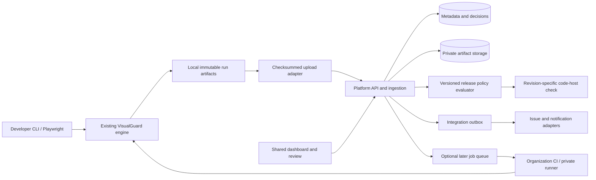

# VisualGuard: organization adoption and product growth plan

Current setup instructions are consolidated in [local source setup](LOCAL-SETUP.md) and [npm package setup](NPM-PACKAGE-SETUP.md). This planning record retains its original phase sequence and historical scope; it is not a separate installation guide.

**Prepared:** 14 October 2026  
**Source reviewed:** local checkout `8a27413`  
**Status:** proposed product and engineering plan; new capabilities below are not shipped APIs.  
**Planning audience:** project owner, frontend leads, QA, designers, platform engineering, and engineering management.

**Implementation update, 15 October 2026:** The standalone dashboard release candidate now includes F01 history, F02 access, F06 upload scope, MongoDB/PostgreSQL and local SQLite storage, evidence export/restore, package commands, and hosting scaffolds. See the [complete walkthrough](NPM-PACKAGE-SETUP.md) for local use, installation in another project, and deployment. Feature commits remain separate. Formatting, linting, and type checks are deferred until after F36 at the user's request; focused behavior tests and JavaScript/UI builds are used during implementation. Public npm publication and live cloud deployment have not been performed.

## 1. The recommendation

**Scope update, 17 October 2026:** Keep current work focused on visual regression. F04 approved baselines has merged; F05 named journeys and deterministic datasets is deferred at the user's request. Continue using existing screenshot checks and capture profiles without requiring a scenario catalog, application fixtures, or journey authoring. Before selecting the next implementation, assess remaining F06 CI upload gaps; F07 can then build visual review and exact-revision checks around the existing check identities. Managed runner scheduling remains demand-driven. This update takes precedence over the original journey-oriented sequencing and targets below; it does not authorize another feature implementation.

**Next standalone unit, after merge of PR #9:** the Phase C F03 pilot combines review storage, permission-checked APIs, and the run review/inbox UI on `codex/collaborative-review`, branched from merged `main`. It adds job-level visual decisions, discussion, assignment and deadlines with exact-evidence concurrency checks. See the [implementation boundary and manual walkthrough](NPM-PACKAGE-SETUP.md#11-team-reviews-approved-baselines-and-github-checks). No local checks, builds, or tests were run for this follow-up. F05 named checkpoints and F04 approved reference promotion form the next reference-workflow release, with separate feature commits; F07 remains a later informative gate.

**Standalone follow-up:** confirmed project/run deletion with project permissions, access/upload cleanup, and preservation of shared evidence is implemented separately. See the [deletion guide](NPM-PACKAGE-SETUP.md#11-team-reviews-approved-baselines-and-github-checks). No build, formatting, lint, type checking, or tests were run for that follow-up, per the user's updated instruction.

**CLI follow-up:** `visualguard test [project]` binds new evidence to a local or hosted project by ID or exact permitted name. See the [project binding guide](NPM-PACKAGE-SETUP.md#8-enable-login-and-connect-other-projects). It is a separate feature commit with no executed checks or builds, per the same instruction.

**Project setup follow-up:** idempotent `visualguard dashboard project create <id>`/`project add` adds projects from the CLI, locally or through an authorized administrator session. See the [setup guide](NPM-PACKAGE-SETUP.md#5-run-npx-visual-regression-with-a-local-sqlite-dashboard). This is another separate feature commit with no executed checks or builds.

Grow VisualGuard into **an internal UI quality platform that helps teams understand, review, and resolve changes before and after release**.

The existing engine is already substantial. The next adoption barrier is organizational: multiple projects need one place to see results, an accountable way to approve changes, stable references, ownership, and predictable execution. Add that foundation before investing heavily in more autonomous AI.

The first organizational product should answer:

1. What changed in this pull request or deployment?
2. Which pages, components, and important journeys are affected?
3. Who needs to review it, and what evidence did they approve?
4. Can we release this exact revision under our team's rules?
5. If something is broken, can we reproduce it and verify a repair?

**Build first:** central run history, identity and project permissions, collaborative reviews, approved baseline versions, named journeys, and a private-runner upload workflow. Add a reliable PR gate after the pilot has measured noise and review effort.

**Develop later:** component impact analysis, targeted test selection, design-system checks, production incident correlation, responsive breakpoint discovery, and feature-flag interaction testing.

**Proposed differentiator:** explainable evidence plus reproducible, verified repair, with execution inside the organization's own environment. This is a positioning hypothesis to validate with users, not a claim that competitors lack these capabilities.

## 2. Assumptions and how to adjust them

The organization's industry, size, infrastructure, and delivery team were not specified when this draft was prepared. Use these assumptions for sizing, then replace them during discovery.

| Planning input    | Working assumption                                                              | Adjustment if different                                                                              |
| ----------------- | ------------------------------------------------------------------------------- | ---------------------------------------------------------------------------------------------------- |
| Initial audience  | 2 frontend teams; 1–2 pilot applications                                        | One app: start with CI artifacts and shared review; dozens of apps: add quotas and ownership earlier |
| Broader adoption  | Approximately 5–15 web apps and 20–100 potential users                          | Hundreds of apps require separate capacity planning and stronger isolation                           |
| Application stack | React/Next.js first; existing Playwright tests where available                  | Prioritize another adapter only when a pilot needs it                                                |
| Code hosting      | GitHub initially, matching existing integration                                 | Use the organization's actual CI and code host; do not build every connector                         |
| Hosting           | Internal deployment with organization-controlled runners                        | Hosted execution requires a separate data and network design                                         |
| Delivery staffing | 2 engineers, with part-time QA/design/platform support                          | A solo maintainer should ship a smaller artifact-upload pilot first                                  |
| Time horizon      | 12–16 weeks for a narrowly scoped pilot product; 6–12 months for wider features | These are estimates, not delivery commitments                                                        |
| AI policy         | Optional and advisory; local/no-AI mode available                               | Teams allowing external AI can enable it project by project                                          |
| Test information  | Seeded accounts and synthetic fixtures                                          | Real customer data requires approved capture and retention rules                                     |

No current market prices, staffing rates, published package versions, or measured production capacity are assumed. All targets in this document are proposed acceptance thresholds unless explicitly described as historical measurements.

## 3. Current foundation and the actual gaps

This plan builds on [the current README](../README.md), [the reliability changes](RELIABILITY-CHANGES.md), and selected source files. The earlier [project analysis](PROJECT-ANALYSIS-AND-ROADMAP.md) is useful history, but its F01–F12 findings describe an older checkout. The reliability guide records their implementation; they should not be reopened as missing features without fresh evidence.

| Area                     | Present in the reviewed checkout                                                                    | Growth opportunity                                                         |
| ------------------------ | --------------------------------------------------------------------------------------------------- | -------------------------------------------------------------------------- |
| Visual testing           | Live comparisons, saved baselines, pixels, DOM changes, regions, noise handling                     | Team-managed evidence and comparison history                               |
| Real application capture | Routes, discovery, authentication, stabilization, hooks, responsive viewports, configurable browser | Named reusable journeys, datasets, and coverage profiles                   |
| Interactive tests        | Playwright fixture with per-check `referenceSetup`                                                  | Organization-wide scenario catalog and parity diagnostics                  |
| Results                  | React HTML reports, filters, image views, local accept/fix actions                                  | Durable shared dashboard, discussions, assignments, audit trail            |
| References               | Rendering metadata, compatibility checks, explicit missing-baseline policy                          | Branch/release baseline lineage and controlled promotion                   |
| CI                       | GitHub Action, PR comments, summaries, JSON/JUnit, webhooks                                         | Revision-specific organizational release checks and required reviewers     |
| Scaling runs             | Concurrency, shards, provenance, completeness validation                                            | Private worker scheduling, quotas, queue visibility, operational recovery  |
| AI                       | Gemini/Ollama, request caching, budgets, intent, advisory mode                                      | Project policy, approved providers, consistent evaluation, aggregate usage |
| Repairs                  | Source ranking, proposals, verification, rollback, optional worktree/PR workflow                    | Shared repair evidence, ownership, organizational scope controls           |
| Other checks             | Accessibility, performance, broken images, failed requests, overflow                                | Longitudinal tracking and issue lifecycle across releases                  |
| Monitoring               | CLI/scheduled production comparisons                                                                | Incident ownership, approved release references, deploy correlation        |

Important source observations:

- [`server/report-server.ts`](../packages/visualguard/src/server/report-server.ts) serves one saved run locally with a session action token. It is not an organizational identity or multi-project backend.
- [`core/types.ts`](../packages/visualguard/src/core/types.ts) defines `RunManifest` schema version 1 with run provenance and jobs. Keep this engine format distinct from the platform's schema.
- [`core/accepted.ts`](../packages/visualguard/src/core/accepted.ts) stores screenshot/change fingerprints, timestamps, notes, and run references. Organizational approval needs authenticated actors, policy, scope, and revocation on top.
- [`src/index.ts`](../packages/visualguard/src/index.ts) exposes the runner and reporter contracts. These are suitable seams for artifact ingestion without rewriting capture or comparison.

The reliability guide records a 9 October evaluation of **43 fixture cases**, with **100% heuristic regression precision and 64.7% recall** under that evaluation's definitions. Six regression cases remained classified for review. These are historical fixture results, not organizational performance guarantees; they support starting with visible reviews and measuring release policy separately from classifier labels. See [recorded validation](RELIABILITY-CHANGES.md#validation-recorded-on-9-october-2026).

No builds, browser tests, live AI requests, or benchmarks were run for this planning exercise.

## 4. Who uses the product and why

| Persona                      | Main need                                                          | Primary workflow                                                     | Evidence of value                                           |
| ---------------------------- | ------------------------------------------------------------------ | -------------------------------------------------------------------- | ----------------------------------------------------------- |
| Frontend developer           | Find a meaningful UI issue without sorting hundreds of screenshots | Open PR result → inspect grouped evidence → reproduce or propose fix | Less time locating the cause; fewer escaped defects         |
| QA engineer                  | Cover important states consistently                                | Manage journeys and fixtures → triage failures → record outcomes     | Repeatable coverage and fewer manual release checks         |
| Designer/design-system owner | Review intended changes across apps                                | Review component/page changes → comment → approve scoped evidence    | Faster review and fewer inconsistent shared components      |
| Engineering lead             | Decide whether a release has sufficient evidence                   | Inspect coverage, unresolved findings, approvals, and exceptions     | Clear release decisions and fewer unexplained green results |
| Platform engineer            | Operate testing without unpredictable infrastructure use           | Configure runners → monitor queue, failures, storage, quotas         | Predictable execution and manageable support burden         |
| Product owner                | Understand impact on important journeys                            | Review annotated screenshots and critical-path status                | Clearer decisions without needing source-level detail       |

**Example end-to-end use:** a shared-button change affects checkout on mobile. CI captures a seeded checkout journey against an approved reference; VisualGuard explains the overlap and associates affected pages with the checkout team. A designer approves the intentional color change, while the overlap stays unresolved. A developer proposes a source fix, verifies the captured scope, and uploads fresh evidence. The release check succeeds only for that reviewed revision after required tests and approvals are complete.

## 5. Feature portfolio: 36 ideas

Priority means **P0: pilot foundation**, **P1: next expansion**, **P2: validate before investment**, **P3: research**. Effort bands are incremental engineering estimates after prerequisites: **S: 0.5–1.5 engineer-weeks; M: 2–4; L: 5–8; XL: 9–16+**. They include implementation and focused validation, but exclude discovery, organization approvals, and broad infrastructure work. Shared foundations reduce some costs; bands should not be added as a fixed delivery schedule.

### 5.1 Organization and daily workflow

| ID  | Idea                                       | Concrete benefit and example                                                        | Priority             | Effort                                     |
| --- | ------------------------------------------ | ----------------------------------------------------------------------------------- | -------------------- | ------------------------------------------ |
| F01 | Central quality dashboard                  | One searchable history for every app, commit, environment, and run                  | P0                   | L                                          |
| F02 | Organization login and project permissions | Designers can review; CI can upload; maintainers control policies                   | P0                   | M                                          |
| F03 | Collaborative review inbox                 | Assign changes, discuss regions, record approval/rejection and review deadlines     | P0                   | L                                          |
| F04 | Approved baseline registry                 | Trace which revision/reference was approved and safely promote release references   | P0                   | L                                          |
| F05 | Named journey and data catalog             | Reuse “checkout with coupon,” “empty dashboard,” and “expired session” states       | P0                   | M–L                                        |
| F06 | Private runners and reliable upload        | Run browsers on internal networks and publish evidence without transferring cookies | P0                   | M for CI upload; XL for managed scheduling |
| F07 | Release policy and PR gate                 | Require critical coverage and the right approvals for the exact PR revision         | P0 after observation | M–L                                        |
| F08 | Ownership and impact grouping              | Show one shared-header incident with all affected routes and the responsible team   | P1                   | M                                          |
| F09 | Jira/Linear and Slack/Teams adapters       | Create one deduplicated issue or alert with evidence and a stable link              | P1                   | M per selected pair                        |
| F10 | Team profiles and onboarding wizard        | Apply common capture/review policies across repos; explain effective overrides      | P1                   | M                                          |
| F11 | Portable evidence bundle and redaction     | Export a checksummed run with selected data removed for another reviewer            | P1                   | M                                          |
| F12 | Noise and quarantine workbench             | Explain unstable regions and time-bound flaky checks with owner and expiry          | P1                   | M                                          |

### 5.2 Coverage, quality, and diagnosis

| ID  | Idea                                               | Concrete benefit and example                                                       | Priority     | Effort |
| --- | -------------------------------------------------- | ---------------------------------------------------------------------------------- | ------------ | ------ |
| F13 | Coverage profiles across browser/theme/locale/role | Keep critical combinations on PRs and broader combinations on nightly runs         | P1           | M–L    |
| F14 | Storybook/component adapter                        | Catch button/modal/table regressions before page-level suites                      | P1           | M–L    |
| F15 | Component-to-page impact graph                     | Map a shared token/component change to apps, pages, stories, and owners            | P1           | L–XL   |
| F16 | Selective test planner with coverage ledger        | Run likely affected checks quickly while showing exactly what was skipped          | P1 after F15 | L      |
| F17 | Design-token and brand contracts                   | Flag forbidden colors, typography/spacing drift, and inconsistent themes           | P1           | M–L    |
| F18 | Accessibility regression history                   | Track introduced/resolved violations, focus changes, and owned exceptions          | P1           | M–L    |
| F19 | Performance and layout budgets                     | Compare repeatable metric distributions and identify new layout shifts             | P1           | M–L    |
| F20 | Content, localization, and RTL checks              | Find truncated labels, untranslated keys, missing content, and wrong direction     | P1           | M–L    |
| F21 | Production incident and deployment timeline        | Link visible production drift to deployment, owner, and incident evidence          | P1           | L      |
| F22 | Approved AI gateway and usage controls             | Enforce per-project providers, request preparation, budgets, and analysis versions | P1           | M–L    |
| F23 | Repair review center                               | Share candidate cause, patch, target verification, and collateral checks           | P1           | L      |
| F24 | Evidence API and agent/editor integration          | Let approved tools query findings and propose repairs using structured evidence    | P2           | M–L    |

### 5.3 Outside-the-box opportunities

| ID  | Idea                                      | Concrete benefit and example                                                           | Priority | Effort            |
| --- | ----------------------------------------- | -------------------------------------------------------------------------------------- | -------- | ----------------- |
| F25 | Responsive breakpoint explorer            | Search widths between standard devices to find the first overlap or clipping           | P2       | M–L               |
| F26 | Layout stress testing                     | Exercise long names, 200% text, empty data, large tables, missing images, slow fonts   | P2       | M                 |
| F27 | Feature-flag interaction guard            | Catch combinations such as new checkout + new promo panel that break together          | P2       | L                 |
| F28 | UI semantic contracts                     | Assert that a critical action remains visible, enabled, reachable, and correctly named | P2       | M–L               |
| F29 | Visual release time machine               | Search how an element looked across releases and when a change first appeared          | P2       | M–L after history |
| F30 | Cross-app consistency radar               | Find incompatible versions or token use across internal apps using shared components   | P2       | L–XL              |
| F31 | Figma-to-runtime review                   | Compare mapped design frames and tokens to an actual state with an explained mismatch  | P2       | L–XL              |
| F32 | Synthetic incident replay                 | Turn an approved support reproduction into a seeded regression journey                 | P2       | L                 |
| F33 | UI change budget and visual debt          | Track reviewed change volume, stale exceptions, and recurring unresolved issues        | P2       | M                 |
| F34 | Evidence-grounded review assistant        | Ask “What changed in checkout?” and receive linked evidence with clear uncertainty     | P2       | M–L               |
| F35 | Visual contract tests for AI-generated UI | Require agent-created changes to satisfy approved screenshots, states, and invariants  | P2       | L                 |
| F36 | Preview-environment resilience laboratory | Explore missing APIs, slow responses, font failure, and third-party outages            | P3       | L–XL              |

Do not treat the catalog as an obligation to build everything. The sections below define a focused first product and experiments that can earn a place on the roadmap.

## 6. Detailed specifications for the initial organization product

### 6.1 F01 — Central dashboard and run history

**Problem:** reports live inside individual run directories or CI artifacts. Team members cannot easily compare runs, find earlier decisions, or see coverage across apps.

**First scope:** projects, run list, commit/PR/deploy metadata, status filters, route/check detail, existing image comparison modes, durable links, and artifact ingestion. Reuse report components where practical. Preserve offline reports for local users.

**User flow:** open project → filter runs by PR/environment → inspect summary and completeness → open job → view screenshots, DOM evidence, independent findings, and provenance → enter review.

**Implementation:** a separate web/API application; a normalized index in PostgreSQL; image/DOM/report files in private object storage; a versioned ingest adapter for current manifests. Keep original artifacts immutable. Do not require a database in the existing CLI.

**Acceptance:** ingest at least 20 representative existing runs; every indexed job resolves to its correct artifacts; repeated upload creates one run; incomplete uploads cannot display a release-ready result; permitted users can follow stable links; historical results remain interpretable after an engine upgrade.

**Measure:** pilot target of under 2 seconds at the 95th percentile for indexed run-list/detail metadata at agreed load. Measure image transfer separately. Dependencies: F02, F06 upload, storage lifecycle.

### 6.2 F02 — Identity, permissions, and accountable actors

**Planned extension:** [Google sign-in, invitations, and user administration](TEAM-ONBOARDING-PLAN.md) defines a separate implementation branch after F03, including identity continuity, invitation acceptance, administrator controls, storage atomicity, and validation. It is planning only and does not expand PR #13's implementation scope.

**Problem:** local action tokens do not tell the organization who reviewed a change or who may change project policy.

**First scope:** one organizational identity provider through OIDC; project memberships; authenticated review actors; short-lived project-scoped CI upload credentials; administrative audit events. Reuse an identity provider/library rather than implementing passwords. Add SAML or automated provisioning only when required by the organization.

**Roles:** Viewer reads permitted projects; Reviewer comments and decides scoped changes; Project Maintainer manages scenarios, reference promotion, and project rules; Organization Admin manages membership, system settings, and runner registration. CI uploader can upload to a project and read needed references, but cannot approve. These roles are independent of application test personas such as “customer” or “administrator.”

**Implementation:** enforce authorization in every API and artifact access path. Store actor IDs rather than trusting an `author` field supplied by CI. Audit permission changes, decisions, policy changes, promotions, and revocations. Do not expose the existing local report server as the shared backend.

**Acceptance:** a user with access to app A cannot retrieve app B evidence by URL or object key; removed users lose access within the defined session lifetime; upload credentials cannot approve; every decision records a trustworthy actor and timestamp. Dependency: early choice of identity provider.

### 6.3 F03 — Collaborative review, region decisions, and inbox

**Problem:** whole-job acceptance is too broad when a screenshot contains both an intentional redesign and a real defect.

**First scope:** assignment, comment threads attached to a job/region/finding, explicit approve/reject decisions, reasons, and an inbox by owner. Group likely shared causes for navigation. Bulk operations show the exact members before submission; grouping never implicitly approves all members.

**Decision model:** distinguish `comment`, `approve_visual_change`, `reject_visual_change`, and `grant_policy_exception`. An approval binds to the evidence version and selected scope. An exception also requires owner, reason, expiry, and applicable policy. A comment is not approval.

**Implementation:** keep engine evidence immutable; store decisions separately; use optimistic concurrency so a stale review cannot approve replacement evidence. Region matching must include surrounding change/finding identity, not just screen coordinates. Start with exact evidence matching; introduce similar-change reuse as an explicit, inspectable policy later.

**Acceptance:** an approved color change does not waive another overlap; two reviewers racing cannot erase decisions; new evidence invalidates affected approvals; rejected/expired scopes stay visible; independent health/accessibility checks retain their own decisions. Target: median review time decreases by 30% relative to the pilot's initial workflow.

**Dependencies:** F01, F02, stable finding IDs, F04 promotion rules. A first pilot can ship job-level decisions and defer general region matching.

### 6.4 F04 — Baseline registry, lineage, and promotion

**Implementation:** see [approved baseline implementation and local testing guide](LOCAL-SETUP.md#9-review-changes-baselines-and-visual-policies). The maintainer confirms that the source revision landed; automatic repository merge verification remains part of later repository/release integration.

**Problem:** “latest capture” and “approved expected appearance” are different references, especially with concurrent PRs and moving production.

**First scope:** immutable baseline versions, branch/release labels, source revision, rendering/capture identity, chosen reference explanation, promotion history, and restore-as-new-version.

**Suggested policy:** PRs compare to the approved target-branch reference captured under compatible settings. A reviewed PR result can become a candidate; the shared target reference advances after the relevant change lands and required review is satisfied. Concurrent/rebased changes require comparison to the current target reference when lineage is uncertain. Missing references remain visible as new/uninitialized checks, never silently green.

**Implementation:** retain the engine's rendering compatibility rules. Add named baseline sets with per-check artifact references and lineage. Use compare-and-swap promotion against the expected current version; a stale promotion gets a conflict and requires re-evaluation. Store the promoting actor, policy version, and evidence digest. Restoring an earlier baseline creates a new promotion event.

**Acceptance:** two racing promotions cannot silently overwrite one another; rebased/force-pushed PRs do not retain stale approvals automatically; browser/theme/locale references do not mix; removed checks require an intentional coverage change; every run explains its selected baseline. Dependencies: F01–F03, revision metadata, canonical check identity.

### 6.5 F05 — Named journeys and deterministic datasets

**Status:** deferred at the user's request on 17 October 2026. The scope below is retained for future consideration and is not part of the current visual regression release.

**Problem:** URLs alone miss modals, error states, empty states, role-specific views, and multi-step interactions.

**First scope:** a source-controlled catalog of named scenarios with owner, tags, criticality, compatible environments, setup/replay, fixture version, checkpoints, and teardown. Use existing Playwright tests and `referenceSetup` before designing another test language.

**Initial examples:** login; permission denied; dashboard loading/empty/populated; checkout with coupon; checkout validation error; modal open; long localized navigation; search with no results.

**Implementation:** stable scenario/checkpoint IDs; setup failures recorded as execution errors; readiness assertions for target state; synthetic users and API fixtures; matching replay on reference and candidate. Version seed contracts and sanitized fixture hashes. Keep credentials outside artifacts.

**Acceptance:** both captures demonstrably reach the same intended state; an expired session/login redirect cannot count as a passing checkout; unchanged seeded scenarios survive repeated runs; teardown leaves shared data clean. Target: each pilot app covers at least five agreed critical journeys at desktop/mobile checkpoints. Dependencies: application owners providing reliable test data and state assertions.

### 6.6 F06 — Private execution and robust artifact upload

**Problem:** internal apps need trusted network access, authenticated capture, and reliable evidence delivery without forcing a hosted browser service.

**Stage A, pilot:** run the existing CLI in approved CI; upload checksummed artifacts using a narrow adapter/reporter; show run lifecycle and upload progress; retry transient upload failures. No custom browser scheduler is needed initially.

**Stage B, expansion:** registered private runners, capability labels, leased jobs, heartbeats, cancellation, resource limits, browser-image/version metadata, per-project quotas, and dead-letter diagnostics. Reserve source editing and verification for a separate opt-in runner capability.

**Implementation:** runner initiates outbound connections; credentials come from the organization's secret mechanism; an upload session declares artifacts, sizes, and hashes; finalize only after all required artifacts validate. A lease has an attempt ID and fencing token so a late worker cannot overwrite a newer attempt. Retry infrastructure failures within limits; preserve deterministic test failures as evidence.

**Acceptance:** killing an uploader/runner mid-run cannot create complete green evidence; duplicate upload/finalization is idempotent; lost leases are recovered; cancellation records partial scope; artifacts never include raw auth state. Measure queue delay, capture duration, retries, and upload duration separately. Stage B depends on pilot demand and measured CI limitations.

### 6.7 F07 — Release policy and exact-revision PR checks

**Visual regression implementation:** [F07 scope and testing guide](LOCAL-SETUP.md#9-review-changes-baselines-and-visual-policies). Uses existing screenshot IDs and profiles; named journeys remain deferred. GitHub delivery starts informative and needs scheduled/on-demand reconciliation for later changes and expiry.

**Problem:** an engine status alone does not express the organization's reviewer, coverage, freshness, or exception rules.

**First scope:** versioned project policies and a GitHub check attached to the candidate commit. Policy describes required scenarios/profiles, blocking finding classes, required approvals, evidence freshness, completeness, and allowed exceptions.

**Policy evaluation returns:** `pending`, `satisfied`, `blocked`, or `error`, with reasons. Keep this separate from existing engine job statuses. The organization's branch protection remains the enforcement point.

**Example:** checkout must run desktop/mobile; changed visual evidence needs one checkout reviewer; shared-brand changes also need a design-system reviewer; capture errors and missing critical scope block; an intentional screenshot approval does not waive an independently failing request check.

**Implementation:** evaluate `(candidate revision, evidence digest, baseline version, policy version, current decisions)`. New commits supersede old evidence. Webhook/check delivery uses retries and reconciliation so dashboard and code-host state converge. Policy exceptions are explicit and expiring. Do not let AI confidence alone authorize a release.

**Acceptance:** a new commit cannot inherit an old passing gate; changed policy invalidates the relevant assessment; missing shard/upload blocks; offline platform produces pending/error rather than an invented success; recovery reconciles status. Roll out as informative checks first, then required checks on selected stable journeys.

**Dependencies:** F01–F04, reliable F06 CI evidence upload, measured pilot repeatability, and code-host permissions. F05 is deferred: the initial visual regression policy uses existing check identities and capture profiles without a named journey catalog. Initial policy can require all changed jobs to be reviewed while region-level decisions mature.

### 6.8 F08/F12 — Ownership, grouped causes, and noise management

**Problem:** a shared change produces dozens of duplicate reviews, while persistent noise teaches reviewers to ignore results.

**First scope:** explicit route/scenario/component owner mapping, optional CODEOWNERS hints, deterministic clusters by source/style/token/selector evidence, recurrence history, and a noise report. Include excluded regions and masking percentages.

**Implementation:** compute a stable cluster fingerprint and keep individual findings underneath. Manual overrides beat inferred ownership. Suggested masks require review and expiry where appropriate. Quarantined checks still run diagnostically, retain their owner/reason, and appear as uncovered or nonblocking scope under policy.

**Acceptance:** a shared header creates one inbox group with all members; an unrelated checkout defect remains independent; masking suggestions cannot silently alter capture policy; expired quarantine surfaces automatically. Measure distinct actionable incidents, masked area, quarantine age, and reviewer reversals. Dependencies: F03, F05; F15 improves grouping later.

## 7. Specifications for the next growth layer

### 7.1 F13–F16 — Coverage profiles, component checks, and impact planning

**Coverage profiles:** name explicit combinations rather than blindly multiplying routes × browsers × themes × locales × roles. Proposed profiles: `pr-critical`, `nightly-broad`, and `release-critical`. Pairwise coverage can reduce combinations, but named high-risk combinations remain mandatory.

**Component adapter:** accept a published/internal Storybook build and story identifiers; capture selected states using the same engine; preserve full-page journeys. A component screenshot cannot prove that the component integrates correctly on a checkout page.

**Impact graph:** ingest source imports, workspace relationships, stylesheet/token usage, story mapping, and configured page/scenario ownership. Add runtime observation only where needed. Every edge records its origin and certainty; dynamic imports, CSS globals, and opaque dependencies may require broad fallback.

**Selective planning:** output selected, inherited, and skipped checks with reasons. Always select critical smoke checks and expand to broad coverage for shared CSS, fonts, capture policy, dependencies, unresolved graph edges, or incompatible baseline identity. Run scheduled full suites and sample skipped scope in shadow mode.

**Acceptance:** a changed shared token selects mapped consumers; ambiguous changes trigger conservative fallback; the coverage ledger never describes skipped checks as freshly executed; held-out changes do not show unacceptable missed impact before selection can enforce gates.

**First experiment:** build an offline change-to-scenario planner for one repo and compare its suggestions to full runs over 20–30 representative PRs. Only make it an execution optimization after measuring misses. Target: reduce captured checks by 30% on eligible changes without a known missed blocking issue in the pilot dataset; report sample size and uncertainty.

**Context:** dependency-aware component selection and independently approved theme/locale modes already exist in commercial tooling. Treat these as useful workflow expectations, then specialize around private execution and verified remediation. [Chromatic TurboSnap](https://www.chromatic.com/docs/turbosnap/), [Chromatic modes](https://www.chromatic.com/docs/modes/).

### 7.2 F17/F20 — Design contracts and localization

**First scope:** a versioned token allowlist, critical component rules, locale-aware overflow/truncation checks, RTL profiles, and synthetic long-content fixtures. Rules identify an owner and evidence source. Allow deliberate exceptions per theme or component.

**Examples:** primary button uses approved brand token; checkout action has a minimum target size under the team's design rule; German labels do not clip; Arabic navigation uses the expected direction; light/dark error states remain legible.

**Implementation:** compare computed styles to resolved approved token values; link findings to element/source candidates where possible. Distinguish token misuse from equivalent values and document tolerances. Label heuristics such as “untranslated key” as suspected until deterministic context confirms them.

**Acceptance:** seed a token violation and a clipped translated label; both are detected with location and rule version; approved equivalent values do not create constant noise; exceptions expire. Dependencies: F13–F15 are helpful; start with manually mapped selectors and tokens.

### 7.3 F18/F19 — Quality trends with separate evidence

**Accessibility:** add stable finding identity, introduction/resolution history, keyboard/focus checkpoints, and owned exception tracking over existing axe checks. Avoid claiming that an automated passing report establishes accessibility conformance; human evaluation is still needed. [W3C accessibility introduction](https://www.w3.org/WAI/fundamentals/accessibility-intro/).

**Performance:** use repeated captures in a controlled environment, recording metric distributions and run conditions. Require both a material effect threshold and enough repeat samples before treating a small difference as a regression. Keep synthetic measurements separate from real-user telemetry.

**Acceptance:** existing defects and newly introduced findings are distinguishable; visual acceptance cannot dismiss independent checks; a noisy performance sample produces an inconclusive finding rather than a definitive release failure. Start with five repeat samples for experiments, then choose sample counts from observed variance; this number alone is not statistical assurance.

**Measures:** newly introduced violations, exception age, repeatability, metric change ranges, and actual investigation time. Dependencies: F01, F05, F07, reproducible runtime.

### 7.4 F21 — Production guard and incident correlation

**First scope:** scheduled critical journeys, release-approved references, deployment metadata, incident grouping, acknowledgement, resolution, and a deployment timeline. Keep “previous observation” and “approved release baseline” as separate reference modes.

**Why this matters:** current monitoring supports updating references; an organizational guard must explain its update policy so repeated observations cannot quietly normalize unwanted release drift.

**Implementation:** use synthetic read-only accounts or a safe sandbox for production journeys; attach deploy ID/commit, request failures, asset hashes, and applicable trace links. Correlate by time, route, and revision; describe candidate causes rather than asserting causality. Trace IDs can connect browser/request evidence to other telemetry when the application propagates them. [OpenTelemetry traces](https://opentelemetry.io/docs/concepts/signals/traces/).

**Acceptance:** an approved deployment advances the reference through explicit promotion; the same unresolved incident produces updates rather than repeated new alerts; acknowledgement does not approve the screenshot; resolution is supported by a fresh capture. Target: reproduce selected seeded incidents within two monitoring intervals.

**Dependencies:** F04, F05, F08, F09, deployment integration. Actual production write operations require an application-specific design; they are not part of the default monitor.

### 7.5 F22–F24 — Organization AI, repair center, and evidence API

**AI controls:** approved provider/model policy, per-project quotas, request redaction, advisory default, complete known-usage ledger, cache/model/prompt versions, and analysis outcome history. Source upload and image/DOM transmission are separate policy choices.

**Repair center:** show likely source candidates and uncertainty, original revision/file hashes, patch, consent/policy, commands, saved-reference verification, collateral scope, and rollback outcome. Execute editing inside the appropriate private source runner. A web reviewer requests a proposal; an authorized developer approves application; publishing follows the organization's existing workflow.

**API/tool integration:** start with authenticated read/query and evidence-bundle export. Later expose separate operations for proposal creation and approved execution. Responses include evidence IDs and suggested verification scope. Never translate arbitrary screenshot/page text into trusted execution instructions.

**Acceptance:** denied-provider requests never leave the runner; budget/provider failures keep deterministic results visible; stale source rejects application; unverified patches are clearly labeled; any future bot PR records the checked revision and scope; API clients cannot bypass project permissions or approvals.

**Measures:** provider fallback, known token usage, proposal acceptance, target repair success, collateral failure, and correct source ranking. Dependencies: F02, F06, F15 for expanded impact coverage. Existing verified repair remains useful without building all this first.

## 8. Outside-the-box experiments with decision criteria

These should begin as small, opt-in experiments against preview environments. Each has a falsifiable hypothesis and a reason to stop.

| Idea                               | Small first experiment                                                                        | Mechanism and prerequisites                                                                                                                            | Advance when / stop when                                                                                                                           |
| ---------------------------------- | --------------------------------------------------------------------------------------------- | ------------------------------------------------------------------------------------------------------------------------------------------------------ | -------------------------------------------------------------------------------------------------------------------------------------------------- |
| F25 Responsive breakpoint explorer | Sweep 320–1600 CSS pixels on 10 critical pages, then refine widths near detected failures     | Detect overlap/overflow/control visibility at coarse intervals; re-capture fresh states near transitions; nonmonotonic layouts need multiple intervals | Advance if it finds useful failures missed by normal profiles; stop if state instability dominates or runtime is unacceptable                      |
| F26 Layout stress testing          | Apply 8 approved fixture mutations to 5 journeys                                              | Long text, empty list, large number, missing image, slow font, enlarged text, validation errors, dense table; deterministic seeds                      | Advance if actionable issues are reproducible; stop if fixtures do not represent plausible product states                                          |
| F27 Flag interaction guard         | Model 6 relevant flags on checkout; use pairwise candidates plus mandatory risky combinations | Flag metadata, compatible-state constraints, seed data, profile budget; compare matching reference/candidate flag states                               | Advance if interactions escape ordinary tests; stop if infeasible combinations dominate. Pairwise tests cannot cover all higher-order interactions |
| F28 UI semantic contracts          | Define 10 deterministic contracts on login/checkout/settings                                  | Role/name identity; visibility, enabled state, geometry, keyboard reachability; application assertions for expected behavior                           | Advance if it detects pixel-invisible changes or prevents noise-based suppression; stop if rule maintenance exceeds saved investigation time       |
| F29 Visual time machine            | Index one component across the last 20 retained releases                                      | Element identity, screenshots, baseline lineage, source/deploy metadata, text search; later optional embeddings                                        | Advance if incident investigation becomes faster; stop if identity drift makes historical comparison misleading                                    |
| F30 Consistency radar              | Inspect header/button/input across 3 apps sharing a library                                   | Explicit component/token mapping, package versions, theme exceptions                                                                                   | Advance if owners act on real inconsistency; stop if unrelated product design differences dominate                                                 |
| F31 Figma-to-runtime review        | Manually map 5 design frames to exact seeded states                                           | Authorized Figma access, frame/token version, font/assets, viewport normalization, component mapping                                                   | Advance if explained findings beat ordinary designer review effort; stop if frame-state mismatch produces excessive noise                          |
| F32 Synthetic incident replay      | Convert 3 approved support reproductions into regression fixtures                             | Manually reproduce using synthetic data, captured state assertions, owned teardown; no raw customer session ingestion                                  | Advance if issues become durable automated checks; stop if cases cannot be reproduced without sensitive live data                                  |
| F33 Visual debt ledger             | Track 30 accepted exceptions with owners and expiry for a month                               | Decision history, recurring finding identity, issue status                                                                                             | Advance if teams retire stale exceptions; stop if it becomes a vanity score or punitive ranking                                                    |
| F34 Review assistant               | Answer 20 historical review questions with source-linked findings                             | Permission-filtered evidence retrieval; structured answers; explicit unknowns                                                                          | Advance if answers are correct/useful and always traceable; stop if it invents causes or retrieves unauthorized evidence                           |
| F35 AI-generated UI contracts      | Run 10 agent-created changes against approved checkpoints and semantic rules                  | Read-only evidence first; existing patch/verification workflow; source and scope controls                                                              | Advance if evidence improves review quality; stop if passing only target screenshots hides neighboring failures                                    |
| F36 Resilience laboratory          | Inject 4 fault types into one preview journey                                                 | Mocked slow/missing API, absent font, broken asset, failed third-party widget; defined recovery expectations                                           | Advance if degraded states are testable and useful; stop if failures are too artificial. Keep production fault injection outside this scope        |

**Best early bets:** F25, F26, and F28. They extend the existing Playwright/DOM engine, can be demonstrated locally, and do not require a large platform or speculative model capability.

**Most strategic later bet:** F15 plus F30. An organization-specific map of UI dependencies, owners, approved behavior, and historical incidents can make VisualGuard useful across teams. Validate its accuracy before relying on it to skip tests or declare cause.

## 9. Proposed architecture

### 9.1 Preserve the engine and add a separate platform

**Pilot deployment:** one API/web deployment, PostgreSQL, private object storage, an existing identity provider, and existing CI. Use a database-backed ingest/outbox worker where sufficient. Introduce a dedicated broker/runner scheduler only after workload requires it. Kubernetes, microservices, and a bespoke browser fleet are not pilot prerequisites.

**Potential repository additions, not existing paths:** `apps/platform/`, `packages/platform-contracts/`, `packages/platform-client/`, and later `packages/runner/`. The platform UI may use Next.js if the team wants it; the current Vite report and local CLI need not be migrated.

### 9.2 Contracts and data entities

| Entity                    | Minimum information                                                                             | Invariant                                                           |
| ------------------------- | ----------------------------------------------------------------------------------------------- | ------------------------------------------------------------------- |
| Organization / Project    | ID, name, ownership, memberships, policy references                                             | Every query and artifact is scoped to authorized project membership |
| Scenario / Check          | Stable ID, checkpoint, owner, criticality, fixture version, allowed profiles                    | Renaming display text does not erase history                        |
| Capture Profile           | Browser/rendering identity, viewport, locale/theme/role, policy hashes                          | Incompatible references cannot be silently compared                 |
| Run / Attempt             | Engine manifest version, source revision, deploy/PR metadata, expected scope, attempt/lease IDs | Partial/duplicate attempts cannot become an ordinary complete run   |
| Artifact                  | Content hash, size, media type, private object reference, redaction version                     | Finalized evidence is immutable and checksummed                     |
| Finding                   | Stable evidence ID, type/severity, selector/region, check, provenance                           | Finding identity and engine classification remain inspectable       |
| Baseline Set / Version    | Check-to-artifact mapping, source revision, lineage, profile/capture identity                   | Promotion is atomic against an expected current version             |
| Review / Decision         | Actor, action, scope, evidence digest, policy version, reason, timestamp                        | Decisions do not approve unreviewed replacement evidence            |
| Exception                 | Owner, reason, scope, expiry, approving role                                                    | Expiry and policy changes are re-evaluated                          |
| Release Assessment        | Candidate revision, evidence/baseline/policy versions, decision digest, outcome/reasons         | A gate applies to exactly the assessed revision and evidence        |
| Runner / Lease            | Registration, capabilities, last heartbeat, assignment and fencing token                        | Late or revoked workers cannot finalize newer work                  |
| Audit / Integration Event | Actor/source, event ID, target, payload version, delivery status                                | Repeated delivery does not duplicate approvals/issues/alerts        |

**Canonical check identity proposal:** hash project + stable scenario/checkpoint + rendering profile + fixture/capture policy identity. Store source revision and baseline lineage as evidence provenance rather than changing the check's stable name on every commit. Hard rendering compatibility should retain engine semantics; do not unnecessarily invalidate every reference for an irrelevant patch version.

**Versioning:** retain raw `RunManifest` v1; import through a versioned adapter into a separate platform envelope. Unknown required fields/versions fail ingestion with a clear diagnostic. Migration must preserve the original evidence and never reinterpret an old review as a new approval.

### 9.3 Run lifecycle and proposed API surface

Platform lifecycle: `created → uploading/running → ingesting → complete`, with `failed`, `cancelled`, and `incomplete` alternatives. Review/policy assessment is a separate lifecycle after sufficient evidence exists.

Proposed endpoints, **not current APIs**:

| Operation                                    | Purpose                                                              | Essential semantics                                    |
| -------------------------------------------- | -------------------------------------------------------------------- | ------------------------------------------------------ |
| `POST /v1/projects/{id}/upload-sessions`     | Declare run envelope/artifacts and obtain scoped upload destinations | Project auth, size limits, idempotency key             |
| `POST /v1/upload-sessions/{id}/finalize`     | Validate hashes/scope and ingest evidence                            | All required artifacts; immutable finalized digest     |
| `GET /v1/projects/{id}/runs`                 | Filter indexed history                                               | Pagination and project authorization                   |
| `GET /v1/runs/{id}`                          | Fetch metadata and permitted artifact references                     | Private expiring access; evidence version              |
| `POST /v1/findings/{id}/decisions`           | Record scoped review                                                 | Actor from session; evidence version precondition      |
| `POST /v1/projects/{id}/baseline-promotions` | Advance approved reference                                           | Expected current version; required decisions           |
| `GET /v1/runs/{id}/assessment`               | Explain revision-specific release result                             | Policy/baseline/decision versions and missing scope    |
| `POST /v1/runs/{id}/repair-proposals`        | Request an optional private-runner proposal                          | Explicit project capability; source revision and scope |

The API emits versioned events such as `run.completed`, `finding.assigned`, `decision.recorded`, `baseline.promoted`, and `assessment.changed`. Use a transactional outbox for external delivery, retries, and deduplication. Start with ordinary indexed search; add image/vector search only when a validated use case needs it.

### 9.4 Data handling and artifact lifetime

Proposed defaults for discovery: failed/review runs retained 90 days; ordinary passing run artifacts 30 days; promoted references retained while any current policy/run needs them; compact metadata and audit events retained according to organizational policy. These are product defaults to approve with application owners, not legal retention guidance.

Mask sensitive regions **before** screenshot capture/upload and sanitize DOM/text/source excerpts independently. A blacked-out screenshot does not redact DOM JSON. Exclude credentials, storage state, environment files, and raw request secrets. Record whether evidence was redacted; redaction changes comparison scope and must remain visible.

Restrict artifact serving by project; render uploaded text/report content as untrusted data. Ingestion validates paths, types, and sizes instead of assuming every CI archive is safe. Workers inherit network constraints appropriate to the project. Test pages and source text do not receive authority to trigger platform actions.

For the internal pilot, use the organization's approved storage/encryption/backup mechanisms. The plan does not establish compliance certification. Include a restore exercise and runbook before declaring the shared service operational.

## 10. Delivery roadmap and staffing

### 10.1 A scoped 12–16-week pilot product

For **two engineers**, reserve approximately **18–24 effective engineer-weeks** within 24–32 nominal engineer-weeks. The difference covers discovery, review, support, platform coordination, and contingency. It does not fit every feature's full specification: region matching, scheduler, selective execution, advanced integrations, and broad repair UI stay later.

| Phase                                         | Calendar estimate | Deliverables                                                                                                                        | Exit criteria                                                                              |
| --------------------------------------------- | ----------------- | ----------------------------------------------------------------------------------------------------------------------------------- | ------------------------------------------------------------------------------------------ |
| A: discover and baseline                      | Weeks 1–2         | App/team inventory; hosting/identity decision; 10–20 critical checkpoints; current review/noise/runtime measurements; pilot owners  | Named apps/users, seeded state, agreed scope and success targets                           |
| B: share evidence                             | Weeks 3–6         | F01 history/detail; F02 one OIDC provider and project roles; F06 CI upload; private artifacts; versioned ingest                     | Complete runs upload reliably; isolation checks pass; dashboard useful to pilot users      |
| C: review and references                      | Weeks 7–10        | F03 job/finding decisions and comments; F04 baseline versions/promotion; F05 catalog layered onto existing tests; initial ownership | A real PR can be reviewed by a second person; promotion is revision-aware and race-safe    |
| D: informative gate and operational readiness | Weeks 11–12       | F07 simple versioned policy; exact-revision GitHub check; completeness reasons; monitoring, backup/restore, runbooks                | Shadow-mode assessment agrees with agreed human decisions; failure recovery demonstrated   |
| E: controlled adoption and buffer             | Weeks 13–16       | Fix pilot feedback; stabilize journeys; optional one alert adapter; gate only selected reliable critical checks                     | Pilot outcome meets targets; owners accept support model; expand/iterate decision recorded |

The shorter 12-week result is an **informative internal pilot**, assuming identity/storage/CI are readily available. The 16-week result may include selected required gates after repeatability is established. Broader organizational gating is conditional on evidence, not the calendar.

### 10.2 Indicative effort allocation for this reduced scope

| Workstream                                         | Engineer-weeks | Scope boundary                                                 |
| -------------------------------------------------- | -------------- | -------------------------------------------------------------- |
| Discovery, contracts, environment integration      | 1–2            | One identity provider and one deployment model                 |
| Ingestion, artifacts, run index, history/detail UI | 4–5            | Existing capture/report logic reused                           |
| Identity, roles, authorization, audit essentials   | 2–3            | No custom password service or provisioning suite               |
| Decisions, comments, baseline promotion            | 4–5            | Job/finding scope first; general region matching deferred      |
| Journey metadata and CI upload integration         | 2–3            | Existing Playwright tests/CI; no managed runner scheduler      |
| Simple policy/GitHub checks and reconciliation     | 2–3            | One code host; no generalized policy language                  |
| Load/failure checks, operations, pilot feedback    | 3              | Focused operational validation and iteration                   |
| **Total range**                                    | **18–24**      | Application teams still contribute fixtures and scenario setup |

### 10.3 Months 4–6: expand where the pilot shows demand

Add project templates, richer review scope/grouping, noise/quarantine tools, an initial component adapter, coverage profiles, localization checks, and selected issue/notification integrations. Introduce scheduled private runners only if existing CI cannot meet the workload or monitoring needs.

Begin an offline impact planner and prototype the repair review center. Expand from 1–2 apps to roughly 3–5 before broad rollout. Use quality and support measurements to determine capacity; app counts alone are not load estimates.

### 10.4 Months 7–12: strategic capabilities

Consider production incident correlation, verified selective execution, shared-component impact across apps, design contracts, and the best-performing experimental ideas. Figma comparison, agent tools, and conversational assistance remain conditional on real users and evaluation.

### 10.5 Solo-maintainer alternative

Keep the existing CLI/CI as execution; ship checksummed upload, an authenticated single-organization history app, basic reviewers, and manual reference promotion. Use code-host review as the initial decision surface where possible. Defer in-product region decisions, managed runners, and many integrations. Re-estimate after the first app works; a full platform is not a credible one-person four-week scope.

## 11. Implementation backlog for the first phase

Effort here is indicative focused engineering days, excluding waiting for external teams. Tasks share setup work; do not add these independently to the phase budget.

| Ticket    | Task / owner                                                   | Dependencies | Acceptance / estimate                                                                              |
| --------- | -------------------------------------------------------------- | ------------ | -------------------------------------------------------------------------------------------------- |
| VG-ORG-01 | Pilot discovery and app/journey inventory / product owner + QA | None         | Two apps, owners, environment/data constraints, 10–20 checkpoints; 2–3 days                        |
| VG-ORG-02 | Platform envelope and importer contract / backend engineer     | 01           | Import current representative complete/incomplete manifests; version behavior documented; 2–3 days |
| VG-ORG-03 | Database/object storage and project model / backend + platform | 02           | Private storage, migrations, local deployment, backup path; 3–4 days                               |
| VG-ORG-04 | OIDC and project roles / backend engineer                      | 01, 03       | API/artifact permissions enforced; actor identity trusted; 4–6 days                                |
| VG-ORG-05 | Upload adapter and finalization / backend engineer             | 02–04        | Hash validation, idempotence, interrupted upload, scope completeness; 4–6 days                     |
| VG-ORG-06 | Run history and compare detail / frontend engineer             | 02–05        | Real uploads searchable; correct images/DOM/findings; stable links; 5–8 days                       |
| VG-ORG-07 | Scenario/checkpoint identity and catalog / frontend + QA       | 01, 02       | Stable names, owners, criticality, fixture/profile metadata; 3–5 days                              |
| VG-ORG-08 | Review decisions/comments / frontend + backend                 | 04, 06, 07   | Scope/evidence binding, stale review conflict, decision audit; 5–7 days                            |
| VG-ORG-09 | Baseline sets and atomic promotion / backend engineer          | 05, 07, 08   | Version lineage, compatibility, racing promotion, rollback event; 5–7 days                         |
| VG-ORG-10 | Versioned assessment service / backend + QA                    | 07–09        | Complete current evidence + decisions → reasons/outcome; separate engine/policy states; 3–5 days   |
| VG-ORG-11 | Exact-revision GitHub check / backend + platform               | 10           | New commit supersedes status; retry/reconcile works; 3–4 days                                      |
| VG-ORG-12 | Operational controls and pilot sign-off / platform + QA        | 04–11        | Retention, restore, failure runbook, agreed load, shadow pilot outcomes; 5–7 days                  |

Use milestone demos instead of waiting for all tickets: first shared run; first second-person review; first atomic baseline promotion; first correct PR assessment; first recovery after an interrupted run.

## 12. Validation plan and definition of organization-ready

### 12.1 Validation layers

| Layer               | What to validate                                 | Representative cases                                                                                        |
| ------------------- | ------------------------------------------------ | ----------------------------------------------------------------------------------------------------------- |
| Engine contract     | Existing guarantees survive platform integration | Saved-reference replay, rendering mismatch, accepted visual change + independent failure, incomplete shards |
| Ingestion           | Evidence identity and completeness               | Missing artifact, corrupt hash, duplicate session, unknown schema, malformed/oversized artifact             |
| Permissions         | Project and action boundaries                    | Cross-project URL/object lookup, revoked member, CI token trying to approve                                 |
| Review and baseline | Correct decisions under changes and concurrency  | Two reviewers, new capture, force push, new policy, two competing promotions, restored reference            |
| Release assessment  | Exact scope and revision                         | Missing critical journey, stale reference, expired exception, platform/code-host delivery outage            |
| Private execution   | Recovery and repeatability                       | Interrupted upload, revoked lease, runner crash, retry, expired session, browser version mismatch           |
| User workflow       | Actual usefulness                                | Developer, QA, and designer review representative real PRs without maintainer assistance                    |
| Operation           | Sustainable deployment                           | Capacity run, storage pruning, backup restore, issue/alert deduplication, on-call diagnosis                 |

For new platform code, use focused contract/integration tests and a few end-to-end workflows. Preserve existing engine tests and evaluations. Run broader browser matrices where new profiles/adapters justify them; do not multiply every organizational test by every browser and operating system.

### 12.2 Proposed pilot success targets

| Metric                | Definition                                                               | Initial target / use                                                                                          |
| --------------------- | ------------------------------------------------------------------------ | ------------------------------------------------------------------------------------------------------------- |
| Repeatability         | Unchanged seeded check producing an unexpected visual finding            | Below 2% over at least 100 repeated check executions per pilot app; report environment and sample uncertainty |
| Review effort         | Median active time reviewing a representative changed PR                 | At least 30% below the pilot's starting workflow                                                              |
| Execution reliability | Runs finalized successfully, excluding genuine application test failures | At least 98% across 100 representative runs; report upload/runner failure separately                          |
| Critical coverage     | Required named checkpoints with compatible, fresh evidence               | 100% for a gated revision; unknown/skipped scope visible                                                      |
| Review correctness    | Known blocking seeded cases receiving satisfied release assessment       | Zero in the agreed invariant suite; broader empirical misses reported separately                              |
| Reviewer usefulness   | Reviewed finding groups judged actionable by pilot reviewers             | At least 80%, with reasons for noise recorded                                                                 |
| Review turnaround     | Elapsed time from ready evidence to required decisions                   | Agree a working-hours target with owners; initial proposal: one business day                                  |
| Adoption              | Weekly active reviewers outside the maintainer                           | At least 5 across the two teams during the pilot                                                              |
| Escaped defects       | Organization incidents that included a UI issue                          | Establish a baseline; classify whether selected coverage could have detected them                             |
| Support burden        | Maintainer hours spent recovering/troubleshooting                        | Establish in the pilot; cap acceptable weekly burden before expansion                                         |

These targets do not prove universal accuracy, especially with small samples. Track classification recall separately from policy success: a review-classified defect may still block correctly under an organization policy requiring review.

### 12.3 Definition of ready for wider internal adoption

The platform is ready to expand when a second team can onboard without maintainer intervention; critical journeys use reproducible seeded state; reviewed references have traceable lineage; current-commit evidence drives the release decision; access and interrupted-run cases pass; users can distinguish complete, partial, unverified, skipped, and inconclusive evidence; backup/recovery works; and project/platform owners agree who supports the service.

## 13. Capacity, operating cost, and value model

### 13.1 Size work by checkpoints, not just pages

Let **C** be named checkpoints, **P** the explicit profiles selected per checkpoint, and **R** runs per day. Comparisons/day = `C × P × R`. Profiles already represent supported browser/theme/locale/role combinations; do not multiply those dimensions again.

Example assumptions: **100 checkpoints × 4 profiles × 20 runs = 8,000 comparisons/day**. With live reference + candidate, that is at least 16,000 primary captures before retries, noise/stability captures, checks, or repair verification. Baseline mode may avoid a fresh live reference; measure the actual extra capture factor from pilot telemetry.

If measured mean worker time is **15 seconds per comparison** and target utilization is **70%**, two workers processing one comparison at a time offer an illustrative daily capacity of `2 × 86,400 × 0.70 / 15 ≈ 8,064 comparisons`. That average capacity does not meet bursty PR demand automatically; size concurrency using peak arrival rate, queue-delay target, memory, and application limits. The 15-second number is an example, not a benchmark of this checkout.

### 13.2 Storage illustration

At an assumed **1.5 MB per comparison bundle**, 8,000 comparisons/day produces roughly **12 GB/day**, or **360 GB for 30 days** before compression, deduplication, differing retention, backups, and large DOM/trace/source artifacts. Real screenshots can vary greatly; measure average and 95th-percentile sizes first.

Object storage deduplicates immutable artifacts by hash where appropriate, but must not leak cross-project artifact presence or access. Retention must preserve promoted references and decision dependencies. Keep browser traces opt-in or failure-only if they dominate storage.

### 13.3 Budget formulas

Monthly operating estimate = API/database + browser worker hours + artifact storage + egress + telemetry/backups + approved AI usage + maintenance time.

AI estimate = prepared input/output token counts × **dated, configured provider rates**, plus known image-related charges where applicable. Failed/in-flight requests can make engine accounting incomplete; reconcile against provider usage when exact cost matters. Do not describe the current token budget as an exact bill or hard financial ceiling.

Illustrative value: if 30 developers each save 20 minutes/week and 5 QA/design reviewers save 1 hour/week, gross recovered time is **15 hours/week**. Subtract review noise, scenario maintenance, and platform support before reporting net benefit. Multiply by the organization's actual internal rates only if needed; do not assign invented salary or prevented-outage values.

### 13.4 Scale triggers

- Add managed runners when CI queue/network/setup limitations repeatedly prevent the agreed latency target.
- Add selective execution when full-scope capture cost becomes material and impact accuracy is measured.
- Add a dedicated queue when ingestion/notification concurrency and retry recovery outgrow the simple worker.
- Add read replicas or search infrastructure only after indexed queries show a measured bottleneck.
- Reassess retention when artifact growth or restore time exceeds the agreed operating budget.

## 14. Main risks and decisions

| Risk                                 | Consequence                                   | Mitigation and owner                                                                              |
| ------------------------------------ | --------------------------------------------- | ------------------------------------------------------------------------------------------------- |
| Too much scope before real users     | A large platform with weak adoption           | Product owner holds the pilot boundary; experiments need evidence to advance                      |
| Unstable data/authentication         | False alarms or wrong-state captures          | Application owner provides seeds/readiness assertions; QA measures repeatability                  |
| Excessive approval/mask reuse        | Real changes disappear from review            | Evidence-bound decisions, separate independent findings, visible exclusions; frontend lead        |
| Poor reference lineage               | Review against the wrong expected appearance  | Atomic promotion, compatibility checks, explicit selection reason; backend engineer               |
| Selective planner misses impact      | Incomplete assurance disguised as speed       | Conservative fallback, critical smoke, shadow/full sampling, visible ledger; testing lead         |
| AI explanation appears authoritative | Reviewers accept invented cause or unsafe fix | Evidence links, uncertainty, advisory policy, verified repair; AI/engine maintainer               |
| Sensitive artifact content           | Unapproved exposure of screenshots/DOM/source | Synthetic data, capture and payload redaction, project access, retention; app/platform owner      |
| Gate delivery/platform outage        | PR status disagrees with evidence             | Pending/error, reconciliation, explicit incident handling; platform engineer                      |
| Browser/runtime drift                | Widespread unrelated diffs                    | Controlled capture image and reviewed reference migration; platform engineer                      |
| Nobody owns reviews or incidents     | Inbox backlog and permanent exceptions        | Ownership map, working-hours expectations, expiring exceptions; engineering lead                  |
| Metrics become team rankings         | Incentives to hide findings                   | Use metrics for coverage and workflow improvement, not individual performance scoring; management |

Decide during discovery: identity provider; hosting/data boundary; pilot apps; source of fixtures; initial profiles; baseline/promotion authority; policy exceptions; code-host integration; owners; artifact retention; whether AI requests may leave the organization. Decisions should record the reason and revisit date, not delay independent engine integration work.

## 15. Adoption and broader project growth

### 15.1 Internal adoption sequence

1. Observe the existing release/review workflow and select one high-value journey per app.
2. Run without required gates; log noisy findings and reviewer effort.
3. Give reviewers stable evidence links and teach status, scope, and reference semantics.
4. Establish owned, repeatable journeys and approved references.
5. Introduce informative exact-revision checks, then require selected critical checks when targets are met.
6. Publish onboarding profiles and let a second team repeat the setup.
7. Expand supported scope only as runner, review, and support capacity allow.

### 15.2 Open-source and eventual product opportunities

Keep local CLI/reporting and no-AI testing usable. Publish clear support/migration guidance, reproducible demos, and benchmark methods with workload and sample size. Add examples for authenticated journeys, Storybook, and internal CI deployment as those features stabilize.

Create an organization onboarding kit: configuration template, synthetic seed recipe, standard profiles, ownership mapping, CI upload example, review/promotion walkthrough, and troubleshooting guide. A good onboarding kit is itself a growth feature.

Potential later offerings are managed metadata/review hosting, enterprise deployment/support, and organization controls. Validate demand and ownership/licensing expectations before choosing paid boundaries; internal adoption does not require building billing or a public SaaS control plane.

For positioning, do not lead only with “AI screenshot testing.” Lead with the concrete outcome: **understand a UI change, get the right review, and retain evidence that a repair worked**. Demonstrate that claim with a real pilot case.

## 16. What to start now, what to defer

**First ten working days:** inventory the pilot apps/users; agree critical journeys; measure repeated unchanged captures and review time; confirm identity/storage; define the platform envelope; import representative artifacts; demonstrate one shared run link; draft baseline/review semantics; turn the first milestone into an issue backlog.

**First release:** authenticated shared evidence, exact run identity/completeness, basic review decisions, approved baseline versions, reliable CI upload, and informative visual regression PR policy. Named journey metadata and deterministic datasets (F05) are deferred.

**After that:** ownership/grouping and noise management, component/coverage profiles, selected integrations, impact experiments, design/locale checks, and a repair center based on actual workflow demand.

**Defer:** a fully autonomous release bot; a custom browser cloud; general-purpose no-code test authoring; mobile native-app testing; a complete observability replacement; universal Figma pixel matching; many model providers; and public billing. Each substantially widens the product before the organizational workflow is validated.

The first success is not feature count. It is two teams using VisualGuard repeatedly to make faster, traceable UI release decisions without depending on its maintainer to interpret every report.

## 17. Research references and limitations

Primary documentation was consulted on 14 October 2026. The observations below establish workflow context, not exhaustive competitor comparisons or superiority claims. External pricing was not used.

| Source                                                                                                                    | Relevant observation                                                                           | Planning implication                                                          |
| ------------------------------------------------------------------------------------------------------------------------- | ---------------------------------------------------------------------------------------------- | ----------------------------------------------------------------------------- |
| [Chromatic TurboSnap](https://www.chromatic.com/docs/turbosnap/)                                                          | Uses source history/dependency relationships for component selection, with broad rebuild cases | Test selection needs conservative fallback and visible provenance             |
| [Chromatic modes](https://www.chromatic.com/docs/modes/)                                                                  | Supports named rendering variants with independent baselines/approvals                         | Make selected combinations explicit and separately reviewable                 |
| [Percy Git baseline management](https://www.browserstack.com/docs/percy/visual-testing-workflows/baseline-management/git) | Offers branch-based baseline selection and configurable approval behavior                      | Reference selection/promotion is a first-class organizational workflow        |
| [Playwright visual comparisons](https://playwright.dev/docs/test-snapshots)                                               | Screenshot behavior depends on execution environment and rendering setup                       | Preserve rendering compatibility and controlled capture environments          |
| [W3C accessibility introduction](https://www.w3.org/WAI/fundamentals/accessibility-intro/)                                | Automated tools alone cannot determine accessibility                                           | Keep automated findings distinct from human accessibility evaluation          |
| [OpenTelemetry traces](https://opentelemetry.io/docs/concepts/signals/traces/)                                            | Traces correlate operations through context across services                                    | Link visual incidents to trace evidence when applications expose that context |

Repository review was static and selective. Historical test/evaluation results are attributed to the repository's recorded validation, not rerun here. Organizational requirements, runtime, workload, and adoption assumptions must be replaced by pilot measurements. Proposed paths, endpoint names, priorities, timelines, and acceptance targets are design choices available for revision.

## Project configuration and dashboard-triggered visual tests — 19 October 2026

The user requested a Run test action in the dashboard and independent test configuration for every project. Build this on the selected-project section from PR #61, preserving offline CLI testing and the existing upload-only credential boundary.

1. Persist a bounded, data-only comparison config per immutable project ID: production/staging URLs, explicit routes, viewports and optional AI provider/model. Maintainers/admins edit with version checks; project-scoped readers can inspect it. Do not store secrets, cookies, executable TypeScript, hooks or arbitrary filesystem paths. Include focused API/storage validation and developer documentation in this feature commit.
2. Add the project configuration editor and Run test UI. A maintainer/admin can request one active execution per project against an exact saved config version. A foreground private runner on the user's computer/CI polls with a separately scoped, expiring runner credential, claims a lease, captures with the existing engine and publishes through the existing evidence upload protocol. Persist progress/result links; handle disconnected runners, lost leases, failures and revocation without silently retrying captures. Hosted dashboard requests must not start browser subprocesses or rely on background serverless tasks. Keep runner/AI credentials on the worker. Include lifecycle/auth tests, a local end-to-end capture and package validation in this feature commit.

This is an on-demand visual-regression workflow. It does not add scheduled managed runners, named journeys, arbitrary job commands, vendor-hosted capture or a general scenario catalog. Formatting, lint and type checks remain deferred under the current repository instruction.
