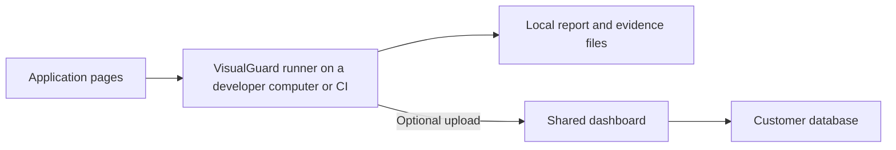

# VisualGuard product features

VisualGuard helps developers and teams find unexpected changes in a website's appearance, understand the evidence, and decide whether a change is ready to ship.

It can compare two running versions of an application, compare an application with saved screenshots, or inspect a screen reached inside an existing Playwright test. You can use it entirely on your computer, or publish results to a shared dashboard for review.

**AI, Google sign-in, a shared dashboard and an external database are optional for the core visual-testing workflow.**

This document explains the current source implementation in ordinary product terms. For installation, use [local source setup](LOCAL-SETUP.md) or [npm package setup](NPM-PACKAGE-SETUP.md).

**Release note — 17 October 2026:** npm currently reports `visualguard@3.1.0`, from revision `b8f2cb04`. Some team features described here were merged after that release, including Google onboarding/account linking, expanded administration, approved baselines and visual policies. Those need a compatible newer release or a current-source installation. This guide is not a claim that every feature is already in the published npm package, or that cloud deployments have been validated.

## Contents

- [Who it is for and how it works](#1-who-it-is-for-and-how-it-works)
- [Ways to compare an application](#2-ways-to-compare-an-application)
- [Page, device and browser coverage](#3-page-device-and-browser-coverage)
- [Stable screenshots and useful differences](#4-stable-screenshots-and-useful-differences)
- [Findings and result statuses](#5-findings-and-result-statuses)
- [Reports and evidence](#6-reports-and-evidence)
- [Optional AI analysis](#7-optional-ai-analysis)
- [Proposed repairs and verification](#8-proposed-repairs-and-verification)
- [Intentional changes and approvals](#9-intentional-changes-and-approvals)
- [Watch mode and scheduled monitoring](#10-watch-mode-and-scheduled-monitoring)
- [CI, pull requests and larger test runs](#11-ci-pull-requests-and-larger-test-runs)
- [The shared dashboard](#12-the-shared-dashboard)
- [Accounts, Google sign-in and permissions](#13-accounts-google-sign-in-and-permissions)
- [Team review and reviewer inbox](#14-team-review-and-reviewer-inbox)
- [Approved baselines](#15-approved-baselines)
- [Visual policies and GitHub checks](#16-visual-policies-and-github-checks)
- [Storage, hosting and data ownership](#17-storage-hosting-and-data-ownership)
- [Backups, audit and recovery](#18-backups-audit-and-recovery)
- [Developer extensions and command map](#19-developer-extensions-and-command-map)
- [Current scope and choosing a starting point](#20-current-scope-and-choosing-a-starting-point)

## 1. Who it is for and how it works

| Reader | Typical use |
| --- | --- |
| Developer | Check a branch or local change before opening a pull request |
| QA engineer | Compare important screens across releases and investigate differences |
| Designer or reviewer | Inspect screenshots and approve the intended appearance |
| Team lead or maintainer | Manage shared references and visual review requirements |
| Platform/operator | Host the dashboard, manage access, preserve evidence and recover the installation |

VisualGuard tests pages a browser can open. It is not limited to the framework used to build those pages: React, Next.js, Vue and ordinary HTML applications can all be comparison targets.

A typical workflow is:

1. **Capture:** open the reference and candidate pages with repeatable browser settings.
2. **Compare:** identify changed pixels, affected elements and independent page problems.
3. **Inspect:** open a local report or publish evidence to the dashboard.
4. **Decide:** investigate a regression, accept an intentional local change, or record a team review.
5. **Reuse:** promote approved evidence as a future reference when appropriate.
6. **Check again:** use the same workflow locally, in CI or through a scheduled run.

The runner executes the browser. The dashboard stores and displays submitted evidence; hosting it does not automatically run tests or schedule browsers.

A **run** is one execution. A **check** is an individual page/viewport or interactive checkpoint comparison. A **baseline** is a saved expected appearance. A **project** groups an application's dashboard history and access permissions. A **revision** is the source commit associated with captured evidence.

## 2. Ways to compare an application

### Compare two running versions

Compare production/reference with staging/candidate. Either side can be a deployed site or a local server. You can map different paths, such as an old `/pricing` page and a new `/plans` page.

**Example:** check that a checkout redesign changes the intended button color without hiding the payment controls.

### Compare against local saved baselines

Capture a known expected appearance, then compare future runs with those stored screenshots. Reference files include rendering information and associated evidence, helping reject incompatible or missing snapshots instead of silently using an unrelated image.

**Example:** a component page has no public production environment, so the team keeps reviewed reference images in its repository or artifact storage.

Creating/updating a local reference is an explicit action. This is separate from the shared approved-baseline registry in section 15.

### Start with one URL or two URLs

The zero-configuration URL mode discovers pages and starts a comparison without a project config. A single-site scan creates an initial reference and compares/updates it on subsequent scans; two URLs compare the two sites.

This is useful for exploration. Use explicit routes and references when you need tightly controlled coverage and approval history.

### Check an interactive Playwright state

The `visualguard/playwright` fixture can check a page after the test logs in, opens a dialog or performs another interaction. A reference setup callback brings the reference page to the matching state, or the fixture can use stored snapshots.

**Example:** compare an expanded shopping cart after adding an item, rather than only the initial `/shop` page. This uses the existing Playwright test; it is not a separate named-journey catalog.

## 3. Page, device and browser coverage

You can configure:

- Explicit routes, route filters and different reference/candidate paths.
- Dynamic route examples, such as specific blog slugs or product IDs.
- Route discovery from Next.js files, sitemaps or crawled links.
- Multiple viewport sizes, including desktop/mobile dimensions and supported device settings.
- Chromium, Firefox or WebKit, with browser-specific capabilities.
- Locale, theme and related browser context settings needed for comparable captures.
- Per-route wait conditions and masking/hiding of known dynamic elements.

Rendering compatibility matters. A screenshot from a different operating system, browser, viewport, theme or locale may not be a valid reference. Chromium has the broadest repository CI coverage; Firefox/WebKit have narrower smoke coverage. Firefox supports responsive viewport sizes but does not apply Chromium-style `isMobile` emulation.

Authentication state and headers can be supplied separately for each tested environment. Capture hooks allow project-specific preparation. These application credentials stay with the execution setup; they are distinct from the account used to sign in to the dashboard.

## 4. Stable screenshots and useful differences

Small variations can make screenshot testing noisy. VisualGuard provides controls to wait for fonts/network quiet, disable animations/transitions, pause media, freeze time, scroll lazy content into view and check capture stability.

You can mask or hide dynamic areas, including elements marked with `data-visualguard-ignore`. For differing pages, reference recapture can identify areas that change by themselves. Noise maps, anti-aliasing handling and pixel/ratio tolerances help separate repeatable changes from rendering variation.

**Example:** mask a changing order number while still checking the order-summary layout.

These controls reduce noise; they do not prove that every ignored difference is harmless. Broad masks or generous tolerances can conceal real changes. Unstable, failed or truncated captures remain relevant evidence when evaluating a run.

## 5. Findings and result statuses

### What the comparison can explain

Pixel differences are connected with captured DOM evidence (the browser's page structure and element details), including changes to text, computed styles, element presence and geometry. Findings can identify changed regions and likely affected elements rather than presenting only a large red screenshot.

Deterministic checks can flag problems such as removed controls, new overlaps, clipping, low contrast, broken images, overflow and HTTP/request failures. Not every visual difference is automatically a regression: a color change may need human review.

Optional independent checks include:

| Check | What it adds | Practical limit |
| --- | --- | --- |
| Accessibility | axe-based comparison of new/worsened violations, even if pixels look similar | An automated check is not a complete accessibility assessment |
| Performance | Browser timings/resource signals and configured increases in loading time (LCP), layout movement (CLS) or page/JavaScript weight | Compare equivalent builds and environments; local development timings are not a production benchmark |
| Capture/page health | Evidence of failed requests, missing images and other supported page problems | Only the visited pages and observed execution are covered |

### Read the result correctly

| Status | Meaning |
| --- | --- |
| **Pass** | Within configured visual tolerance, or permitted noise handling without independent blocking findings |
| **Review** | A difference or independent check needs a decision |
| **Regression** | A deterministic problem or qualifying AI-classified regression was found |
| **Accepted** | The appearance matches a locally recorded intentional change, without hiding new independent problems |
| **Error** | Capture or processing failed |

CLI failure policy can fail on regressions alone or include review results. Errors and explicitly incomplete merged executions fail. A failed command can therefore mean a correctly detected regression, not a broken installation.

A visual policy's **Pending / Satisfied / Blocked** assessment is a separate decision described in section 16. A passing engine run does not itself imply team approval or permission to release.

## 6. Reports and evidence

Each run saves available screenshots, DOM snapshots, changed regions, findings, a machine-readable `manifest.json` and an HTML report.

The report provides:

- Reference/candidate side-by-side comparison.
- Slider, overlay/onion-skin and difference-image views.
- Search, status filtering, job navigation and links to individual results.
- Changed-region and element details, captured problems and available analysis.
- Local acceptance and optional repair actions when served through the CLI.

Static reports can be shared as evidence, but the screenshot files must travel with the report: share the **whole run directory**, not just `index.html`. Actions that change acceptance/source require the local served report rather than a static file or read-only dashboard viewer.

Reports also support JSON/JUnit and CI-oriented summaries. Run retention on the execution machine is configurable and independent of shared dashboard history.

## 7. Optional AI analysis

The core comparison and deterministic explanations work without AI. Gemini or Ollama can add classifications and explanations for uncertain differences. Saved captures can be re-analyzed without opening the application again.

Controls include:

- Which differences are sent for analysis and the expected change context.
- Advisory mode that adds analysis while preserving deterministic status.
- Model selection and prepared image detail.
- Validated request caching and cache expiry.
- Limits on analyses, generation attempts, network retries, token usage and elapsed time.
- Recorded usage/provenance when returned by the provider.

AI cannot downgrade deterministic regressions or waive independent health/check problems. An expected-change description is context, not approval. Provider confidence is not a calibrated probability, and configured budgets cannot always prevent an already-running request from exceeding an estimated token limit.

Enabled providers receive prepared screenshot/DOM inputs. Repair proposals may also send source excerpts after the relevant consent/configuration. Choose the provider and data policy deliberately; self-hosting the dashboard does not automatically make external AI calls local. Provider failure or missing credentials falls back to deterministic analysis.

## 8. Proposed repairs and verification

Repair assistance can locate likely source files and propose scoped class/CSS changes or AI edits. It is disabled by default and configured for the local source repository.

A normal repair flow previews the diff, asks before applying it, then runs configured commands and checks the result against saved reference evidence. Failed verification reverts edits. A broader verification pass checks the original run's captured routes/viewports for collateral changes.

You can restrict editable files, require a verification server, control attempts and inspect saved proposals/results. Source-upload consent is distinct from merely enabling screenshot analysis. Automatic Git mode can create a branch/worktree and commit verified changes; opening a PR is an explicit additional option.

**Example:** propose restoring a changed spacing utility, inspect the patch, then verify that the target screen and other captured screens still match.

Verification covers captured/configured behavior, not every possible application state. Without a verification server, an edit may be labeled unverified. Shared dashboard reviewers do not gain permission to edit a developer's source repository through the read-only comparison viewer.

## 9. Intentional changes and approvals

Three related features serve different purposes:

| Action | Where it lives | What it means |
| --- | --- | --- |
| **Accept a local change** | A local/version-controlled acceptance file | Similar or exact intentional differences can be recognized in later local engine runs |
| **Approve a visual change** | Dashboard review history for exact check evidence | An authorized reviewer accepts that specific shared visual difference |
| **Promote an approved baseline** | Dashboard baseline registry | An authorized maintainer publishes reviewed evidence as an immutable future reference |

A comment does not substitute for a visual decision. Local acceptance does not substitute for shared review. Promoting a reference does not rewrite an older run or prove a GitHub merge.

New independent problems cannot be hidden by a previous local acceptance. New/different shared evidence needs the appropriate current decision rather than borrowing approval from another run.

## 10. Watch mode and scheduled monitoring

### Watch mode

While developing, watch mode re-runs comparisons when source files change. It can narrow tests through page/import relationships; shared or untraceable changes fall back to the wider configured scope.

**Example:** keep comparing the local pricing page while editing its styles.

### Monitoring a live site

Monitor compares a live site with its earlier saved capture. It creates the first reference, then uses the configured update policy; the default preserves references for pages classified as regressed instead of rolling them forward automatically.

A generated scheduled GitHub workflow or another scheduler can repeat monitoring. Persist its reference directory between CI executions. Merely hosting the dashboard does not schedule monitoring or maintain a browser worker.

## 11. CI, pull requests and larger test runs

VisualGuard can run in CI with non-interactive output, JSON/JUnit, report artifacts, job summaries and configured exit policies. Preview deployment URLs can be supplied as the candidate environment.

GitHub-related tools include a composite Action, generated workflows and a sticky PR summary comment. A webhook can send a JSON run summary to a receiver such as an automation service. A configured public report URL supplies a link; it does not host that report.

For larger scopes, concurrency controls how many jobs execute together. Sharding divides one execution across CI jobs. Merge checks execution identity, settings, revisions, duplicates and coverage before creating a combined result. An explicitly partial merge remains diagnostic/incomplete and fails rather than pretending all checks ran.

There are two distinct PR integrations:

- **Run summary/comment:** makes captured results visible on a PR.
- **Dashboard visual policy Check Run:** assesses exact-revision evidence, current references and required review; see section 16.

A comment is not a release gate. Browser jobs and tokens still need the customer's CI configuration and appropriate permissions.

## 12. The shared dashboard

The dashboard groups evidence by project so developers, reviewers and maintainers can work from the same stored run.

Features include:

- Run history and comparison views with project/status/environment/branch/revision/PR/deployment/date filters.
- Project creation from the UI or authorized CLI, with stable identifiers.
- Project and run names, editable by permitted maintainers; earlier public project IDs remain aliases after renaming.
- Imports of local runs and remote project-scoped publishing.
- Role-controlled access, visual review and reviewer inbox.
- Approved baseline sets, policies and operator pages in compatible feature releases.
- Confirmed project/run deletion with reference-aware evidence cleanup.

Publishing transfers evidence in checksummed chunks and can resume the same credential-bound upload after interruption. Original local run files remain available. A run is committed only after its required uploaded evidence validates; importing a genuinely incomplete capture does not make its coverage complete.

Project deletion removes its runs/access/upload credentials while preserving unrelated workspace accounts and evidence still referenced elsewhere. Deleted project IDs remain reserved. Deletion does not erase original runner copies or independent backups, and hosting does not enable automatic time-based retention.

## 13. Accounts, Google sign-in and permissions

### Access choices

- **Local owner:** trusted access on the local computer, without a user account or login setup.
- **Password login:** individual accounts, sessions and password controls.
- **Google/OIDC login:** configured provider identity, with customer-owned credentials and exact callbacks.

Current team onboarding supports explicit Google linking to an existing account after ownership proof. It preserves account IDs/history and does not merge people merely because their emails match. Profile displays the signed-in user's name, email and workspace role.

Invite-only admission allows administrators to issue expiring project/role invitation links. A recipient verifies the intended identity and explicitly accepts; opening the link alone grants nothing. Links can be cancelled/replaced. The product currently provides copyable links, not automatic invitation emails.

### Roles

| Role | Main responsibility |
| --- | --- |
| Viewer | Read evidence in assigned projects |
| Reviewer | Participate in review and record visual decisions |
| Maintainer | Manage the project's access, upload credentials, references and policies, as permitted |
| Workspace administrator | Manage accounts and projects across this installation |

Project permissions and workspace administrator status are separate. There is one workspace per installation, not a vendor-wide multi-tenant super-admin console.

Administrators can search/filter users, inspect details, manage roles, disable/restore accounts, reset existing password credentials and revoke sessions/upload credentials. Sensitive lifecycle actions require current proof and fresh account versions. The last active administrator is protected. Disabling a person retains attributable history; restoring them does not resurrect revoked credentials.

Upload tokens are separate, project-scoped publishing credentials. They cannot create projects, manage users or browse general dashboard history. In feature releases, they can retrieve their project's indexed approved references and perform scoped policy operations. Local-owner access and login-mode localhost are different: login-mode publishing still needs a token.

## 14. Team review and reviewer inbox

On a stored run, a reviewer can select a check, inspect evidence, comment, reply, assign an active reviewer and set an optional deadline. Decisions include **Approve visual change**, **Request changes** and **Withdraw decision**, with a reason.

Review history records the actor, time, source/evidence scope and decision. Conflicting writes require refresh instead of silently replacing another person's action. Deadlines are entered in UTC and displayed in the browser's time zone.

The **Review inbox** helps find assigned work, pending/rejected decisions and overdue items. Its default view focuses on the current reviewer's items needing attention.

The current approval unit is the captured check/job, not arbitrary selection of a few image pixels. Approval applies to that evidence; it does not rewrite capture reliability, independent failures or a different run's result.

## 15. Approved baselines

An approved baseline is the team's recorded expected appearance. Named sets such as `main` or `release-1` contain numbered immutable versions, with the selected checks, image/DOM digests (content fingerprints), rendering identity, source run/revision, review context, actor and reason.

A maintainer selects complete, reliable, reviewed evidence, records its actual landed revision and promotes it. Promotion rejects missing/currently invalid approvals, incompatible evidence and other required failures. The landed-revision confirmation is a maintainer's attestation, not automatic Git ancestry verification.

Runners can download an exact version and compare against it offline. This supports reproducible CI and keeps browser execution in the customer's environment. Approved snapshots reject tampering/incompatible rendering and cannot be overwritten through ordinary local baseline-update flags.

Later promotions create new versions. Restoring an older appearance creates another version with its origin recorded rather than changing history. References used by current evidence/baselines influence deletion protection.

**Example:** approve the new checkout appearance, publish `main` version 2, and compare the next PR with those exact expected screenshots.

## 16. Visual policies and GitHub checks

A visual policy answers: **does the evidence for this exact revision meet this project's current visual requirements?**

Requirements can cover the target branch/environment, required screenshot checks, current approved baseline, evidence age, complete/reliable execution and exact visual approval for changed screenshots.

| Assessment | Meaning |
| --- | --- |
| Pending | Required evidence is not yet available |
| Satisfied | Available evidence meets the current policy |
| Blocked | Evidence or a decision fails one or more requirements |

Policies are versioned with actor/reason. Temporary exceptions are scoped to an exact check/revision with a reason/expiry; they do not waive capture/coverage failures or explicit rejection.

Optional GitHub delivery verifies the live PR head/target and publishes a Check Run for that revision. Informative mode reports the assessment with a neutral conclusion; Required mode distinguishes success, failure and waiting evidence. A new head commit cannot inherit a previous head's evidence.

Webhooks require correctly signed original bytes. Reconciliation refreshes results after evidence, reviews, references, account permissions or freshness change. Operators must configure scheduled/on-demand reconciliation and credential rotation; the integration is not an automatic GitHub App connection/token-refresh service.

Checks are point-in-time observations. GitHub can retain an old conclusion during a dashboard/network outage, so monitoring/recovery matters before making checks required. VisualGuard does not configure branch protection, merge PRs or grant release permission independently of the customer's controls.

## 17. Storage, hosting and data ownership

| Setup | Where data persists |
| --- | --- |
| Standalone tests | Local run/report/reference files; no dashboard database |
| Local dashboard with no DB service | Embedded SQLite file |
| PostgreSQL dashboard | Dedicated PostgreSQL database |
| MongoDB dashboard | Dedicated MongoDB database |
| Vercel/Cloud Run dashboard | Configured external database, not the host's ephemeral filesystem |

New uploaded screenshot/DOM bytes are stored as database-backed artifact chunks alongside platform data. Cloud hosting does not automatically create a Vercel Blob, S3 or Google Cloud Storage bucket. Those are not configurable artifact adapters today.

SQLite supports the local team features without a separate service. PostgreSQL and transaction-capable MongoDB support the full transactional workflow. Standalone MongoDB has a limited compatibility path; invitations, linking, lifecycle changes, baseline mutations and recovery need supported transactions.

The customer owns the installation's database/domain/secrets and decides who gets access. Database storage/backup costs include images, not only accounts and comments. Source and application authentication remain on the runner; enabled AI/GitHub/Google integrations make their own external connections.

Vercel and Cloud Run deployment scaffolds are available. The setup guide explains separate dashboard projects, external databases, canonical URLs and known scaffold corrections. A generated scaffold is not evidence of a validated production deployment or an existing one-click marketplace template.

## 18. Backups, audit and recovery

### Two kinds of backup

- **Portable evidence export/restore:** moves projects, runs and required artifacts between supported dashboard backends or into a local review workspace. It intentionally excludes authentication state.
- **Native operational database backup:** preserves account/access/review/baseline/policy state and new artifact chunks for full installation recovery. Configuration, secrets, DNS and host IAM must be preserved separately.

Restoration should be tested in an isolated workspace. Changing a connection URL selects another database; it does not migrate history. Redeploying an application is not a backup, and rolling back code does not undo database schema changes.

### Audit and readiness

The administrator-only **Audit & recovery** page provides filtered, bounded audit-history pages and sign-in/storage readiness information. It helps investigate access and administrative changes without presenting passwords/raw tokens. Readiness is an inventory, not production certification.

### Administrator recovery

Host-side source/operator tooling can inspect and recover an **existing password administrator**, with an exact account/version, native-backup acknowledgement, reason and privately owned password file. Recovery revokes existing sessions/upload credentials and records an audit event.

It is not an HTTP recovery endpoint or an npm account-creation command. It cannot create/promote users, merge identities or add a password to a Google-only account. The source setup guide contains the supported operator procedure.

## 19. Developer extensions and command map

Developers can use the package API for configuration parsing, run creation, events/results, reporters and cancellation. Capture hooks prepare application state; custom reporters can integrate results into existing tools. CLI HTML/JUnit/webhook behavior is not automatically implied by every programmatic API call.

| Command or API | Main use |
| --- | --- |
| URL mode | Explore one site or compare two URLs quickly |
| `init` / `doctor` | Create config and diagnose setup |
| `test` | Compare configured application pages or stored references |
| `test PROJECT` | Compare and save new evidence to a dashboard project |
| `report` / `analyze` | Inspect or re-analyze saved evidence |
| `accept` | Record an intentional local change |
| `fix` | Propose/apply/verify a configured repair |
| `auth` | Save application login state for browser captures |
| `watch` / `monitor` | Re-test on edits or compare a live site over time |
| `merge` | Combine compatible shards and validate coverage |
| `comment` | Publish/update a PR summary comment |
| `dashboard` | Run the dashboard |
| `dashboard project create` | Create/reuse a project with appropriate authority |
| `dashboard import` / `publish` | Store local evidence or upload to a running server |
| `dashboard export` / `restore` | Move portable evidence |
| `dashboard baseline pull` | Download immutable approved references in a compatible feature release |
| `dashboard policy assess` / `reconcile` | Assess evidence and refresh GitHub delivery in a compatible feature release |
| `dashboard init` | Generate Vercel/Cloud Run hosting files |
| `visualguard/playwright` | Check an interactive state inside an existing Playwright test |
| `visualguard` / `visualguard/dashboard` APIs | Build supported run/reporting/dashboard integrations |

This is a capability map, not a command sequence to run all at once. Use the setup guides and installed command help for version-specific options.

## 20. Current scope and choosing a starting point

Features described as implemented here are distinct from ideas in the roadmap. The current product does not include a managed browser-runner scheduler, a standalone named-journey/data catalog, automatic invitation emails, billing/license enforcement, a multi-tenant vendor control plane, arbitrary issue-tracker/chat adapters or an external screenshot-bucket adapter.

A generic webhook is not a dedicated Slack/Teams integration. A GitHub check is not automatic release authorization. Proposed roadmap features are not additional hidden commands.

Choose the smallest useful starting point:

- **Individual developer:** compare one route and inspect the local report without AI or a database.
- **Team trying shared review:** add a dashboard and project token, then invite reviewers on a compatible release.
- **Team standardizing expected appearance:** adopt approved baselines after practicing exact-evidence reviews.
- **Team adding PR requirements:** start policies in Informative mode and validate reconciliation/failure recovery before requiring checks.
- **Operator:** choose the database/host, preserve backups and verify access/restore behavior before sharing the installation.

Next reading:

- [Run the repository locally](LOCAL-SETUP.md) — current-source demo and team/operator walkthrough.
- [Install the npm package in any project](NPM-PACKAGE-SETUP.md) — tests, dashboard, SQLite/PostgreSQL/MongoDB, hosting and integrations.
- [Technical command/configuration reference](../packages/visualguard/README.md) — detailed developer controls.
- [Architecture map](PACKAGE-ARCHITECTURE.md) — source organization and implementation entry points.
- [Roadmap](ORGANIZATION-GROWTH-PLAN.md) — proposed future scope, not a list of shipped capabilities.

This overview was checked against source commands, configuration, the dashboard and the maintained setup guides. No application code, deployment or provider configuration is changed by this document.
